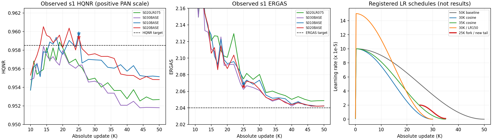

# PAN Aligner 유지 / rotation loss 제외: 스케줄 후속 실험

2026-10-23. 사용자 승인 범위: 기존 s1/s3 결과로 우선순위가 낮은 미완료 case 제외,
스케줄 실험 추가, 총 시간 제한 해제, s3 Git 인계. 새 아키텍처와 밴드 loss는
이번 큐에 섞지 않고 후속 후보로 제안한다.

## 관측과 제외 판단

공동 목표는 **동일 checkpoint의 HQNR ≥ 0.9585 AND ERGAS ≤ 2.040**이다.
현재 확인한 양의 PAN scale 실험에서 공동 목표 달성은 없다. s1은 원본 RR20/FR20
평가 파일을, s3는 기존 검증 publisher가 올린 대표 결과를 확인했다. s3 Sheet는
대표 checkpoint 표시이므로 마지막 학습 step이나 프로세스 생존 여부를 뜻하지 않는다.

| 서버 / 설정 | 대표 step | HQNR | ERGAS | 판단 |
|---|---:|---:|---:|---|
| s1 S010BASE R1 | 25K | 0.959813 | 2.069167 | 25K 분기 source, fresh 30K 및 R2 유지 |
| s1 S020BASE R1 | 25K | 0.959393 | 2.065970 | 25K 분기 source, 30K/35K 기준 |
| s1 S020LR075 R1 | 19K | 0.958868 | 2.102339 | 처음부터 낮은 LR의 추가 반복은 제외 |
| s1 S030BASE R1 | 14K | 0.958406 | 2.131192 | HQNR 미달; 더 큰 scale의 우선순위 하향 |
| s3 S020BASE R1 | 19K | 0.9595 | 2.1007 | 같은 seed의 스케줄 대조 기준 |
| s3 S020H050 R1 | 26K | 0.9590 | 2.0627 | 짧은 스케줄 조합 + 50K R2 반복 |
| s3 S020LR150 R1 | 17K | 0.9593 | 2.0877 | short cosine에서 별도 LR 대조만 유지 |
| s3 S020H200 R1 | 24K | 0.9593 | 2.0787 | Hard 증가 추가 반복 제외 |
| s3 S020LR150H050 R1 | 18K | 0.9586 | 2.0844 | 두 변경의 결합 이득 불명확; R2 우선 제외 |
| s3 S010LR150H050 R1 | 26K | 0.9602 | 2.0679 | scale .1 가능성은 보존; 이번에는 원인 분리 우선 |
| s3 S020BASE R2 | 26K | 0.9592 | 2.0630 | H050 R1과 비슷해 seed 영향을 분리해야 함 |

s3 수치는 Sheet 표시 정밀도이다. 원자료:
[s1 평가와 SHA](../results_log/assets/2026-10-23_schedule_successor_local_evidence.json),
[s3 포함 Sheet 관측](../results_log/assets/2026-10-23_schedule_successor_sheet_snapshot.json).

- **s1 S040BASE R1**: 5,489 update에서 SIGTERM 처리로 정상 checkpoint 저장 후 중단.
  이 case 자체를 끝까지 검증한 결과는 아니며, .3 및 기존 .5의 불리한 추세에 근거한
  자원 배분 결정이다. 기존 실험 결과·checkpoint는 보존한다.
- **s1 S050BASE R1**: 미시작 제외. 기존 mature HALF(.5) 실험과 겹치며,
  기존 .5의 최종 HQNR은 약 .94 수준이었다.
- **s1 S020BASE/S010BASE R2**: 폐기하지 않고 후속 큐로 이동한다. 50K 설정을 유지한다.
- **s3 S020LR150H050 R2**: 미시작이면 skip, 이 case가 실행 중이면 checkpoint를
  남기는 안전 중단 후 전환. 이미 완료되었다면 결과를 그대로 보존한다.
  다른 case 실행 중에는 중단하지 않고 정상 종료를 기다린다.

새 캠페인은 `PANDA_S13_SCHEDULE_HARDONLY_20261023_v1`, 실행 prefix는 `PSC30`이다.
원 캠페인의 30시간 deadline이나 고정 소스를 수정하지 않고 후속 큐를 연결한다.
새 큐에는 총 wall-time 제한이 없다. 디스크 여유 검사·안전 중단·엄격한 재개 검사는 유지한다.

그림의 왼쪽 두 패널은 기존 실측, 오른쪽은 등록된 스케줄이며 새 성능 예측이 아니다.

## 스케줄 가설과 실험 구분

기존 50K cosine은 warmup 100 update, peak LR 1e-4, 최종 LR 0이다.
30K에서 약 3.467e-5, 40K에서 약 9.586e-6이다. 양의 scale 기준
25K의 ERGAS는 2.066~2.069이고, 50K에는 약 2.042가 되지만 HQNR은 .955 전후로
낮아진다. 저 LR와 ERGAS 개선은 함께 관측됐지만, 누적 update 수와 LR의 원인을
분리하지 못했다. D_s가 update 수에만 의존한다고 가정해서도 안 된다.

단순히 기존 50K 실행을 30K에서 끊는 것과 **cosine 자체를 30K로 압축하는 것**은 다르다.
후자는 30K에 LR이 0에 도달한다. 동일 peak LR이면 누적 LR도 감소하므로 underfit할 수 있다.
그래서 peak 1.5e-4 대조를 별도로 둔다. 예산에 맞춘 LR decay가 유효할 수 있다는
일반 근거는 있지만, PAN-Crafter의 공동 목표 달성을 보장하지 않는다.
[Budgeted Training](https://arxiv.org/abs/1905.04753).

**두 계열을 혼동하지 않는다.**

1. **F25C35**: 동일 서버·동일 seed의 기존 BASE 25K checkpoint에서 분기.
   Student, Adam moments/step, RNG, sampler·augmentation 순서, frozen A/T,
   원 calibration을 보존한다. 25,001 update의 LR 2e-5에서 35K의 1e-6까지 cosine.
   추가 학습은 10K이다. 원 25K의 마지막 optimizer LR은 그대로 검증하고 다음 update부터
   선언한 새 schedule을 적용한다. 기존 checkpoint를 새 설정으로 일반 resume하지 않는다.
2. **C30/C35**: 동일 초기화 seed의 새 Student를 처음부터 학습.
   warmup 100, peak 1e-4(명시된 LR150만 1.5e-4), 최종 LR 0.
   기존 50K 설정과 paired seed 대조를 유지한다.

평가는 기존 초기 cadence를 유지하고, 20K~35K를 **1K 간격**으로 촘촘히 평가한다.
분기에서는 25K 이전 평가를 새 실험 성과로 재게시하지 않는다.
공식 평가의 original RR20/FR20, single-view, PAN 양의 scale, GT 좌표는 그대로다.

추정된 ERGAS −.01~−.015만으로는 25K source의 남은 차이(.026~.029)를 모두
메우지 못한다. 따라서 이 실험의 성공 여부는 예상 개선량을 가정하지 않고
실제 공동 통과 수, HQNR 충족 구간의 최소 ERGAS, 반복 seed의 방향으로 판단한다.

## 등록된 큐

기본 Hard 계수는 alpha=.25, gamma=.5, beta=0. H050은 alpha=.125, gamma=.25.
Aligner는 frozen이며 Student 학습·추론 모두 지정 scale로 PAN에 적용한다.
rotation consistency loss, 추가 paired view, soft loss, TTA는 없다.
기존 단일 입력 C4 augmentation만 유지한다.

| 순서 | s1 | s3 |
|---:|---|---|
| 1 | S020F25C35 R1 | S020F25C35 R1 |
| 2 | S010F25C35 R1 | S020C30 R1 |
| 3 | S020C30 R1 | S020C30H050 R1 |
| 4 | S010C30 R1 | S020C35H050 R1 |
| 5 | S020C35 R1 | S020C30LR150 R1 |
| 6 | S020C30LR150 R1 | S020C30 R2 |
| 7 | S020C30 R2 | S020C30H050 R2 |
| 8 | S010C30 R2 | S020H050 R2 (50K) |
| 9 | S020BASE R2 (50K) | — |
| 10 | S010BASE R2 (50K) | — |

s1 10개(새 update 합계 305K), s3 8개(245K). 시간 제한 해제는 이 등록 큐를
끝까지 실행한다는 뜻이며 무한 case 생성은 아니다. 서버별 Stage1 donor가 다르므로
s1과 s3 간 수치 차이를 하이퍼파라미터의 순수 효과로 해석하지 않는다.

## 구조 제안 검토 및 후속 후보

현재 실제 Student는 W112 D123 `PANCrafterPaper`, down/up이 각각 2개다.
down은 Conv3 stride2 pad1, up은 ConvTranspose2 stride2이다.
짝수 격자에서 다운샘플의 샘플링 위상 비대칭은 확인 가능한 구조적 특성이다.
그러나 **avgpool2/resize로 바꾸어도 임의의 learned convolution 필터가 남으므로
네트워크 전체의 C4 회전 등변성을 보장하지 않는다.** conv4 stride2 pad1 역시
격자 중심의 선택을 바꾸며 필터 방향성 자체를 강제하지 않는다.
[Group Equivariant CNNs](https://proceedings.mlr.press/v48/cohenc16.html).

샘플링과 aliasing이 CNN의 이동 민감도에 영향을 줄 수 있다는 근거는 있다.
다만 avgpool2가 완전한 anti-aliasing 해결책은 아니며, pansharpening의 고주파를
약화시킬 위험도 함께 검증해야 한다.
[Making Convolutional Networks Shift-Invariant Again](https://proceedings.mlr.press/v97/zhang19a.html).

사용자 제시 회전 평균 진단의 HQNR +.0048 / ERGAS −.037은 이번에 원본을
독립적으로 찾지 못했다. 이를 검증된 구조 개선량으로 간주하지 않는다.
회전 평균에는 ensemble 효과도 포함되므로 이득 전체를 down/up 구조에 귀속할 수 없다.

스케줄 대조를 마친 뒤, 동일 서버·동일 seed·동일 스케줄·양의 scale=.2·기존 Hard loss를
고정하고 Student만 아래처럼 바꾸는 세 case를 우선 추천한다. Teacher와 Aligner는 고정한다.

| 후보 ID | 변경 | 비교 목적 |
|---|---|---|
| ARCH_DAVG | down만 avgpool2 stride2 + conv3 stride1 pad1 | down 위상 영향 분리 |
| ARCH_UBIL | up만 bilinear x2 (`align_corners=False`) + conv3 pad1 | up 영향 분리 |
| ARCH_DAVG_UBIL | 두 변경 결합 | 개별 이득의 결합 여부 |

실제 CPU 생성 파라미터: 현재 2,658,888; avgpool+resize 조합 2,784,328(+4.72%);
conv4 down+resize up 조합 2,959,944(+11.32%). 따라서 전부 '동일 파라미터'는 아니다.
conv4 또는 nearest 변형은 위 세 대조 이후 후보로 둔다. 공식 추론에는 회전 평균을 넣지 않는다.
1~2 px 이동은 PAN/MS 격자·경계·학습 patch 분포를 함께 바꾸므로, 그 진단 실패만으로
이 구조 후보의 효과를 판정하지 않는다.

## 밴드 loss 제안 검토 및 후속 후보

공식 ERGAS 구현은 `tools/metrics/eval_rr.py`의
`100/r * sqrt(mean_b(MSE_b / mean_GT_b**2))`이며 영상별 값을 집계한다.
따라서 **1/평균 가중 L1은 상대오차 강조의 근사**이지 ERGAS 자체와 같은 목적함수가 아니다.
MSE라면 1/평균² 가중이고, 전체 train 평균과 영상별 GT 평균도 다르다.

첫 후보 **LOSS_BANDREL_L1**:

- 학습 split의 양의 radiometric/DN 공간에서만 밴드 평균 mu_b를 구하고 고정한다.
  [-1,1] 정규화 공간의 평균이나 test GT로 가중치를 만들지 않는다.
- `a_b = (1/max(mu_b, epsilon)) / mean_b(1/max(mu_b, epsilon))`로 평균 가중치를 1로 둔다.
- Student 오차만 `mean_b(a_b * abs(S_b-GT_b))`로 변경한다.
- Teacher d_e, conditional q, mask와 alpha/gamma는 고정해 효과를 분리한다.

이는 기존 Hard의 계수 튜닝을 넘어 **band reduction의 손실 정의 변경**이다.
사용자가 요청한 이번 스케줄 큐에는 포함하지 않고 별도 후속 ablation으로 제안한다.
red/NIR1 기여 비율 및 −.005~−.015 개선량도 원본 검증·실험 없이 확정하지 않는다.
L1+L2 혼합은 두 항의 크기/gradient 정규화와 혼합비를 먼저 정의한 뒤 두 번째 후보로 둔다.

## 게시와 검증

Sheet에는 공동 통과한 모든 checkpoint와 case/replica/attempt별 대표 하나를 게시한다.
대표는 HQNR ≥ .9585 중 최소 ERGAS, 없으면 최고 HQNR이며 중복을 제거한다.
평가 원 정밀도로 선택하고, ERGAS가 목표를 넘는 대표는 통과로 표기하지 않는다.
Stage1은 기존 RRE 선택 결과를 유지한다. fork는 Selected_step/Lifetime_updates=절대 step,
Updates=step−25000으로 기재하고 새 Train(h)에서 상속된 25K 시간을 제외한다.
별도 CUDA cost 측정은 같은 실제 A+S 추론 구조에만 결합한다.

실행 및 인계 절차는 [s3 인계 문서](../results_log/2026-10-23_SCHEDULE30_s3_handoff.md)와
[패키지 README](../panda_schedule30/README.md)를 따른다.

실행 확인(2026-10-23 15:55 KST): s1 전환 상태 `LAUNCHED`, 새 컨테이너 running.
첫 `S020F25C35 R1`의 25001 이후 train trace 증가를 확인했다.
41개 자동 테스트와 8개 고유 설정의 실제 데이터 CUDA preflight가 통과했다.
새 publisher의 Stage1 대표 row 178 게시 및 native Sheet readback도 확인했다.
Student 첫 정식 평가는 26K이며 s3 실행은 해당 서버 에이전트의 인계 작업이다.
