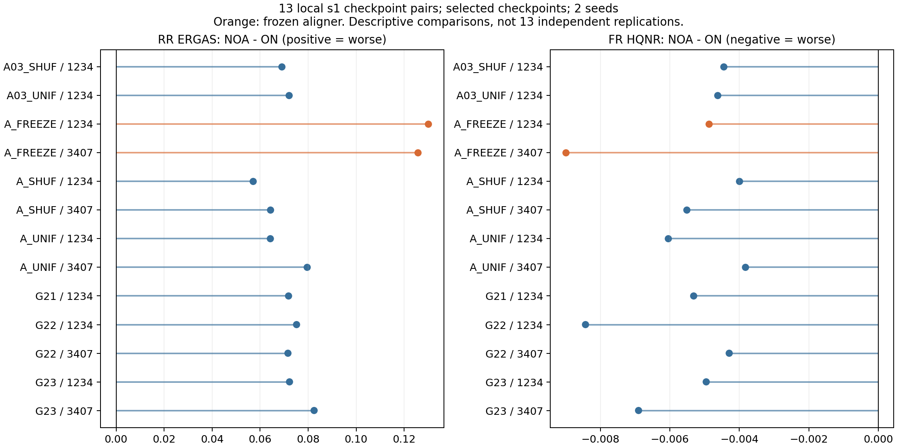
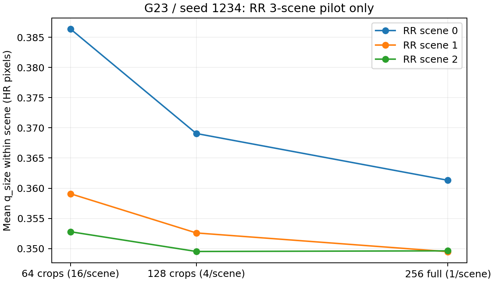

**Aligner 실험 세 축의 근거 분석 — 학습 중 정합 · 추론 NOA · 크기/q_size**

작성: 2026-09-18. 로컬 결과 집계 시점: 10:56 KST, HEAD `3a99515d4e4ff10525633915de2d353902883b05`. 기존 JSON/CSV와 코드·기록을 대조하고 통계를 다시 계산했다. 새 학습·GPU 추론·Sheet 갱신은 실행하지 않았다. 이후 생성되는 결과는 이 분석에 포함되지 않는다.

**현재 근거는 “학습된 모델에서 정합 경로를 유지할 이유”를 강하게 뒷받침한다. 다만 “장면마다 CNN이 물리적으로 정확한 정합을 예측해서 성능이 높아진다”까지 입증하지는 않는다. q_size는 추가 이동에 대한 반응 일관성이고, 정합의 절대 오차가 아니다.** 세 축을 이 구분 없이 합치면 과거의 부정적 결론과 최근 NOA 결과가 모순처럼 보인다.

| 축 | 실제로 묻는 질문 | 확인한 근거 | 판단 |
|---|---|---|---|
| 학습 중 정합 | 어떤 정합 경로·제약으로 학습해야 복원이 좋아지는가? | PA/PO10/NF16 → PALS24/PALSV18, QRC24 학습 대조군 | 약한 offset 제약의 이득은 관측됨. 강한 이동 반응·큰 보정량이 더 좋은 복원을 보장하지 않음 |
| 추론 NOA | 이미 학습된 같은 A/U에서 A와 warp를 제거하면 어떻게 되는가? | 로컬 s1 QRC24 13 checkpoint, 각각 RR20·FR20 paired 결과 | 13/13에서 RR ERGAS·FR HQNR 모두 악화. 현재 모델의 정합 경로 의존성은 명확함 |
| 크기/q_size | 같은 aligner의 반응이 입력 영역 크기에 따라 얼마나 달라지는가? | G23 seed1234, RR 3 scene의 64/128/256 입력 | 큰 입력에서 q가 조금 낮아지는 예비 결과. FR·다른 모델·consensus 복원 이득은 아직 판단 불가 |

**찾은 실험과 주요 기록**

| 기록 | 실험의 위치·용도 |
|---|---|
| [09-09 alignment 분석](../results_log/2026-09-09_alignment-analysis-and-new-baseline.md) | PAN·MS·출력의 고주파/저주파 좌표계 문제. 구형 구조에 대한 배경 관찰 |
| [09-10 PA A1–A3](../results_log/2026-09-10_pa-a1-a3-s1-results.md), [09-12 alignment-axis 판정](../results_log/2026-09-12_s1_alignment-axis-verdict.md) | 초기 정합 학습과 donor 동결/미세조정. 후속 결과 이전의 강한 부정적 판정은 그대로 일반화하면 안 됨 |
| [09-13 PALS24 λ sweep](../results_log/2026-09-13_s1_pals24-lambda-sweep.md), [09-14 PALSV18 확인](../results_log/2026-09-14_palsv18-lambda-confirmed-and-na104-null.md) | 약한 offset consistency 제약과 seed·checkpoint 선택 의존성 |
| [09-15 EQREC4 결과](../results_log/2026-09-15_s1_eqrec4-results.md) | q–복원오차 관계, 텍스처 교란, 고정 모델 개입, 단기 q 가중 실험 |
| [09-17 aligner method audit](../results_log/2026-09-17_pan-aligner-method-audit.md) | donor 반응, 상수 보정 대조, FR 평가 프레임, RR α sweep. 뒤쪽 정정까지 함께 읽어야 함 |
| [09-18 통합 계획 §4·§7](PAN_AllServers_StudentEval_AlignerAnalysis_CurrentMethod_Integrated_2026-09-18.md) | NOA 정의, 동일 checkpoint paired 평가, T0·Student 네 자산의 크기/probe/네 모드 분석 |

**학습 중 정합: 작은 보정의 효용과 정확한 정합 학습의 증거는 다르다.**

PO10의 알려진 이동 감독으로 만든 donor N2는 추가 변위에 대한 반응 기울기 대각 성분이 약 −0.93이었다. 이상적인 보상 반응은 −1이다. 이후 복원과 공동 미세조정한 T0의 selected checkpoint는 약 −0.34였고, offset consistency 제약을 크게 주면 donor 쪽 반응을 더 보존했다. 따라서 이 학습 계열에서는 제약이 donor의 변위 반응을 보존하는 역할을 한다는 해석이 타당하다. 이것을 모든 초기화에서 “정합을 새로 학습하지 못한다”는 일반 명제로 확대할 수는 없다. 이 반응 기울기와 알려진 probe의 EPE도 원래 영상의 물리적 정합 GT는 아니다. [09-17 기록 §3](../results_log/2026-09-17_pan-aligner-method-audit.md)

PALS24/PALSV18의 실제 run mapping과 `checkpoint_metrics.csv`를 사용해 같은 seed의 no-align 대비 raw HQNR 차이를 다시 계산했다. seed는 1234/2025/7777 세 개다. `best`는 각 run의 최고 HQNR, `last`는 마지막 기록, `plateau`는 각 run 마지막 step의 80–100% 구간 평균이다. 양수이면 no-align보다 좋다.

| λ_off | best 차이 평균 | last 차이 평균 | plateau 차이 평균 | 세 seed 모두 양수인가? |
|---|---:|---:|---:|---|
| 0 | +0.002299 | +0.001839 | +0.001968 | 세 집계 모두 그렇다 |
| 3e−5 | +0.001215 | +0.001097 | +0.001124 | best만 3/3, 나머지 2/3 |
| **1e−4** | **+0.004411** | **+0.002284** | **+0.002575** | **세 집계 모두 그렇다** |
| 3e−4 | +0.002185 | −0.010809 | −0.010576 | best 2/3, 나머지 0/3 |

따라서 “정합을 넣으면 언제나 해롭다”는 과거 포괄적 판정은 맞지 않는다. 약한 제약의 이득은 best만의 현상도 아니다. 다만 best에서 보이는 이득이 last·plateau에서는 작아지고, λ=3e−4는 후반에 역전된다. 이는 epoch·선택 기준에 민감하다는 증거다. best와 last의 차이 전체를 선택 편향의 크기로 간주할 수는 없다. 학습 상태도 달라지기 때문이다. 동일 FR benchmark로 선택과 보고를 했으므로 별도 holdout 일반화 효과 역시 확정할 수 없다. 예전 기록의 `0.0031` seed band는 이 모든 비교에 적용할 보편적 유의성 기준이 아니다. [재집계 CSV](Aligner_Three_Axes_Analysis_2026-09-18/historical_selection_deltas.csv)

장면별 예측의 추가 효용은 더 약하다. L1E4 세 seed에서 **같은 학습된 모델**의 보정만 바꾼 FR20 결과는 다음과 같다. 숫자는 HQNR 차이다.

| seed | learned − zero | learned − const_mean | learned − shuffle |
|---|---:|---:|---:|
| 1234 | +0.005971 | −0.000433 | +0.000196 |
| 2025, T0 | +0.006905 | −0.000061 | +0.000079 |
| 7777 | +0.008122 | −0.000174 | +0.000059 |

보정을 완전히 없애면 나빠지지만, 예측을 한 상수 벡터로 대체하거나 scene 간 섞었을 때의 차이는 훨씬 작다. **이 benchmark에서는 장면별 CNN 예측의 추가 이득을 보여 주지 못했다.** 다만 `const_mean`은 같은 평가 20 scene의 aligner 예측을 평균한 값이다. GT를 사용하지는 않았지만, 훈련 데이터에서 미리 고정한 독립 상수 대조군은 아니다. 상수 보정으로 처음부터 학습한 모델의 성능이나 모든 데이터에서의 동등성도 시험하지 않았다. 과거 ZERO는 이번 호출 추적을 거친 NOA와 별도 실험으로 취급해야 한다. [원본 재집계](Aligner_Three_Axes_Analysis_2026-09-18/constant_controls.csv), [원기록 §6](../results_log/2026-09-17_pan-aligner-method-audit.md)

FR의 평가 프레임도 영향을 준다. 09-17 기록에서 동일 V64 support로 비교하면 no-align은 raw 0.95880 → fixed-aligned 0.92333, donor 동결은 0.93985 → 0.96319로 순위가 바뀐다. 그러나 fixed frame 자체가 donor N2이므로 donor 동결에 유리하다. 이 결과는 **프레임 선택에 대한 민감성**을 보여 주며, fixed-aligned를 실제 정합의 정답 점수로 만들지는 않는다. 원 PAN 기준의 공식 raw metric과 보조 프레임 분석을 함께 해석해야 한다.

RR α sweep도 같은 구분이 필요하다. T0의 ERGAS는 α=0에서 2.16862, α=0.5에서 2.09407, 학습 때의 α=1에서 2.06942, α=2에서 2.11972였다. 학습 시 보정을 유지하는 편이 좋지만, 이는 A와 U가 함께 적응한 결과와도 양립한다. 임의의 다른 정합 모델보다 기하적으로 정확하다는 증거는 아니다. 과거 기록의 2.0238 같은 다른 RR 집계값과 이 sweep의 2.0694를 직접 섞어서도 안 된다. [09-17 기록 §13의 정정](../results_log/2026-09-17_pan-aligner-method-audit.md)

**현재 Student의 q/A 학습 대조군은 무엇을 추가로 보여 주는가?**

이번에 확인한 QRC24 13개는 W104D121/T0, factor1 계열이다. λ_E=0.002, α=1, β=0.1이며, G21/G22/G23은 r_A=0.003/0.01/0.03이다. A_UNIF/A_SHUF는 r_A=0.01, A03_UNIF/A03_SHUF는 0.03이고 A에 배정하는 가중만 uniform/shuffle로 바꾼다. 이 대조군에서도 edge 쪽 q 가중은 유지된다. A_FREEZE는 A를 동결한다. **Teacher의 λ_off 실험과 Student의 A 가중 실험은 서로 다른 개입**이다. 현재 Student에는 offset loss를 다시 넣지 않는다.

아래 차이는 앞 모델의 A_ON − 뒤 모델의 A_ON이다. ERGAS는 음수, HQNR은 양수이면 앞 모델이 좋다. 각 run의 기존 selected checkpoint를 비교하므로 step이 서로 다를 수 있다.

| 비교 | seed | ΔERGAS | ΔHQNR | 해석 |
|---|---:|---:|---:|---|
| G22 − A_UNIF | 1234 | −0.027299 | −0.001313 | RR 개선·FR 악화 |
| G22 − A_UNIF | 3407 | +0.010375 | +0.002843 | RR 악화·FR 개선 |
| G23 − A03_UNIF | 1234 | −0.005495 | +0.001310 | 두 지표 개선, 동일 step31310, 한 seed |
| G23 − A03_SHUF | 1234 | −0.021819 | +0.002276 | 두 지표 개선, selected step은 다름 |
| G23 − A_FREEZE | 1234 | −0.037760 | +0.002235 | 두 지표 개선 |
| G23 − A_FREEZE | 3407 | −0.027349 | +0.000226 | 두 지표 개선, FR 차이는 작음 |
| G23 − G22 | 1234 | −0.001176 | +0.004349 | r_A=0.03 쪽 개선 |
| G23 − G22 | 3407 | +0.034080 | −0.000738 | 반대 결과 |

r_A=0.03의 q 배정은 seed1234에서 유망하다. 그러나 r_A=0.01의 uniform/shuffle 비교는 일관된 우위를 보이지 않고, r_A 증가 효과도 seed에 따라 뒤집힌다. 따라서 **현재 결과로 q의 sample별 배정 효과나 특정 r_A의 보편적 우위를 확정할 수 없다.** G23 대 동결의 두 seed 결과는 제한적인 A 미세조정의 효용을 지지한다. no-align 재학습·상수 보정 재학습과의 비교는 여전히 별도 질문이다. [전체 비교와 step](Aligner_Three_Axes_Analysis_2026-09-18/training_contrasts_selected.csv)

**NOA: 현재 학습된 checkpoint에서는 정합 경로 제거가 일관되게 손해다.**

`work_dir/_eval_phase/records/*.json`의 로컬 13개 record를 각 mode의 실제 metric/identity와 대조했다. 모두 s1의 기존 `best_hqnr` 자산이고 독립 seed는 1234/3407 두 개다. 각 checkpoint에서 ON/NOA는 동일 가중치를 사용하며 RR20·FR20을 비교한다. 새 ERGAS 우선 selector의 결과나 새 seed 실험 결과를 섞지 않았다.

| NOA − ON | 13개 평균 | 범위 | 악화한 checkpoint |
|---|---:|---:|---:|
| RR ERGAS | **+0.079674** | +0.057112 ~ +0.130116 | **13/13** |
| RR ERGAS 상대 변화 | **+3.806%** | +2.747% ~ +6.170% | 13/13 |
| FR HQNR | **−0.005551** | −0.008988 ~ −0.003821 | **13/13** |
| FR D_lambda | +0.003241 | +0.002551 ~ +0.004349 | 13/13 |
| FR D_s | +0.002479 | +0.000934 ~ +0.004919 | 13/13 |

각 checkpoint의 FR20에서도 ON이 18–20개 scene에서 좋다. 단순히 한두 장면의 평균 효과만은 아니다. 다만 같은 장면과 seed를 반복 사용한 여러 profile이므로 13개의 독립 반복으로 통계적 확신을 부풀리면 안 된다.

| 대표 자산 | selected step | ERGAS ON → NOA | HQNR ON → NOA |
|---|---:|---:|---:|
| G23 / 1234 | 31310 | 2.071234 → 2.143477 | 0.959148 → 0.954196 |
| G23 / 3407 | 19190 | 2.115349 → 2.197843 | 0.956196 → 0.949297 |
| G22 / 1234 | 31310 | 2.072409 → 2.147590 | 0.954798 → 0.946372 |
| A_FREEZE / 1234 | 22220 | 2.108994 → 2.239109 | 0.956912 → 0.952044 |

이 결과에서는 D_lambda와 D_s가 모두 악화한다. 과거 서로 다른 학습 모델을 비교하며 관찰한 FR 프레임 trade-off가 모든 within-checkpoint NOA 비교에서도 같은 방향일 것이라고 예상하면 안 된다. 동결 A 두 개의 평균 ΔERGAS는 +0.12795, trainable A 11개의 평균은 +0.07090이다. 고정된 보정에 대한 의존성이 더 클 가능성은 있지만, profile 구성이 다르므로 이 차이 자체를 동결의 인과 효과로 해석하지 않았다.

현 checkpoint에서 **정상 A_ON 유지가 타당**하다. 다만 공동 목표 ERGAS<2.040 및 HQNR≥0.9585를 동시에 통과하는 자산은 이 13개에서 ON·NOA 모두 0개다. HQNR 조건만 보면 ON 1개, NOA 0개다. 정합 경로의 효용과 최종 목표 달성은 별개다. [원본 수치 전체](Aligner_Three_Axes_Analysis_2026-09-18/noa_pairs.csv)

검증한 범위에서는 13개 모두 현재 checkpoint/config SHA가 기록과 일치하고, ON/NOA의 공통 identity 항목이 일치했다. 각 split에서 ON의 A/warp 호출은 20/20, NOA는 0/0이었다. 저장된 metric과 record가 일치하고 factor1 학습 manifest 판정도 통과했다. 원 identity에 RR 데이터 hash와 전체 precision/환경 정보가 없어 완전한 재현성 인증은 아니다. 타 서버의 raw artifact는 이번에 가져오지 않았으므로 **이 13개를 전 서버 결과라고 부르지 않는다.** [항목별 대조](Aligner_Three_Axes_Analysis_2026-09-18/noa_provenance_checks.json)

**q_size: 확인된 것은 G23 한 모델의 RR 3-scene pilot이다.**

계획은 T0, G23/1234, G23/3407, G22/1234 네 자산의 RR·FR 크기/probe와 네 추론 모드 분석이다. 그러나 확인한 로컬 `*/results/aligner_eval_v2/*/analysis/size_probe_*.json`은 G23/1234의 `size_probe_rr.json` 하나였다. scene 0/1/2이며, FR 크기 결과와 완결된 `modes.json`은 찾지 못했다. 이 범위에서 분석 전체가 완료됐다고 판단할 수 없다.

원본 scene별로 다시 집계했다. 64 crop 16개, 128 crop 4개, full256 1개가 각 scene에 있다. 총 48/12/3 crop이지만 독립 scene은 세 개다. 아래 값은 각 scene 안의 q_size 평균이다.

| RR scene | 64 crop | 128 crop | full256 | full − 64 |
|---|---:|---:|---:|---:|
| 0 | 0.386387 | 0.369065 | 0.361310 | −0.025077 |
| 1 | 0.359082 | 0.352588 | 0.349483 | −0.009599 |
| 2 | 0.352787 | 0.349516 | 0.349620 | −0.003167 |
| scene 평균 | **0.366085** | **0.357056** | **0.353471** | **−0.012614** |

64→256에서 세 scene 모두 q가 낮아지며 평균 감소는 약 3.45%다. 128→256에서는 scene2가 아주 조금 증가하므로 완전히 단조롭지는 않다. 큰 입력 영역이 변위 반응을 약간 안정화할 가능성은 보인다. 세 scene만으로 일반적 크기 법칙이나 물리적 정합 정확도 향상을 주장할 수는 없다.

64→128에서 각 scene 내부의 dy/dx 표준편차도 감소했다. 하지만 full은 scene당 예측 하나이므로 **scene 내부 분산을 추정할 수 없다.** 원 요약의 모든 crop을 합친 std와 full 세 scene 사이의 std를 비교해 “full의 지역 불확실성이 훨씬 작다”고 해석하면 서로 다른 분산을 비교하는 오류다. 이번 CSV에서는 full의 내부 std를 0 대신 결측으로 기록했다.

full offset − crop64 성분별 median은 scene별 `(dy,dx)`가 `(0.002924, 0.002273)`, `(−0.006350, 0.009311)`, `(0.007594, 0.003135)` px였다. 최대 성분 차이도 약 0.00931 px여서 이 세 scene에서는 대표 이동량이 가깝다. 그렇더라도 **CROP64_MED를 적용한 full U-Net의 RR·FR 결과가 없으므로 consensus 성능 이득은 알 수 없다.** [scene별 통계](Aligner_Three_Axes_Analysis_2026-09-18/qsize_by_scene.csv), [full–crop 차이](Aligner_Three_Axes_Analysis_2026-09-18/full_vs_crop_by_scene.csv)

q_size의 의미는 수식에서도 구분된다. 고정된 크기/위치에서 `c0=A(P,M)`, `cj=A(W(P,εj),M)`일 때 다음 값이다.

\[
q(A)=\frac{1}{2N}\sum_j\|c_j+\epsilon_j-c_0\|_1.
\]

aligner 출력에 상수 편향 벡터 b를 더해도 `q(A+b)=q(A)`다. 따라서 **추가 이동에는 정확히 반응하지만 원래 보정량에 일정한 오차가 있는 aligner도 q=0일 수 있다.** q=0.35를 “정합 오차 0.35 px”라고 읽으면 안 된다. AXIS16 반경 0.25/0.5/1/2의 입력에 전혀 반응하지 않는 상수 출력 aligner는 q=0.46875이다. 이번 0.35 부근은 이 무반응 기준보다 잔차가 작지만 절대 정합 정확도를 뜻하지 않는다.

또한 native64 학습 q, RR256 q_size, FR512 q_size는 입력 내용·유효 영역·공간 해상도 조건이 다르다. 학습 q_ref를 그대로 q_size의 보편적 합격선으로 쓰거나, RR–FR 값 차이를 곧바로 기하 정확도 차이로 해석할 근거가 없다.

**EQREC4는 q를 “좋은 Teacher/낮은 복원오차”로 바로 해석하면 안 되는 이유를 보여 준다.**

원본 `native_sample_metrics.csv`를 다시 읽어 L1E4 best_raw 세 seed의 native64 4096 patch씩을 분석했다. 기록의 텍스처 통제는 각 변수의 rank를 PAN Scharr energy rank에 회귀한 뒤 잔차끼리 Spearman을 계산하는 방식이다. 이를 그대로 재현했고, 통상적인 rank 부분상관인 잔차끼리 Pearson도 별도로 계산했다.

| L1E4 seed | raw ρ(q, ROI L1) | 기록 방식 텍스처 통제 후 | 통상적인 rank 부분상관 |
|---|---:|---:|---:|
| 1234 | −0.123834 | +0.285506 | +0.311688 |
| 2025 | −0.156764 | +0.245671 | +0.276277 |
| 7777 | −0.131358 | +0.311972 | +0.338019 |

L000·L1E2를 포함한 7개 자산 모두 통제 후 양수였다. 따라서 patch 수준의 음의 raw 상관만으로 “q가 작을수록 복원이 원래 나쁘다”거나 “q가 쓸모없다”고 결론내리는 것도 부정확하다. q와 오차가 텍스처에 서로 다르게 연관되어 있고, 조정 후에는 관계가 달라진다. 이것은 교란 가능성의 근거이지, 텍스처의 인과 효과나 q 가중 학습의 효과를 식별한 실험은 아니다. 4096 patch는 128 source block에서 왔으므로 독립 표본 4096개로 유의성을 주장하지 않았다. 이번 재계산은 시각화 보완의 전체 patch 기준이며 초기 H1의 BCD/D subset 통계와도 구분된다. [재계산 CSV](Aligner_Three_Axes_Analysis_2026-09-18/eqrec4_texture_correlations.csv)

반면 FR20의 scene별 q–HQNR 상관은 seed1234/2025/7777에서 −0.683/−0.782/−0.898로 재현됐다. 낮은 scene q가 높은 HQNR과 연관되는 관찰이다. 기존 기록의 scene 텍스처 통제 결과도 이 관계가 유지된다고 보고하므로 patch 수준 설명을 그대로 scene 수준에 적용하면 안 된다. 이번에는 FR의 raw 상관만 재계산했다. [scene 재계산](Aligner_Three_Axes_Analysis_2026-09-18/eqrec4_scene_correlations.csv), [기존 보완 §A.4](../results_log/2026-09-15_s1_eqrec4-results.md)

EQREC4 K20의 5K q 가중 pilot에서는 작은 native L1 이득이 있었지만 HQNR은 모든 arm이 약 0.9555에서 0.951–0.952로 내려갔다. 당시 q gate의 HQNR 이득을 입증하지 못한 결과다. 한 pair·5K의 그 실험과 현재 QRC24의 GT edge/A 연속 가중은 목적과 loss 구성이 다르므로, 이를 현재 q 사용 전체의 반증이나 검증으로 대신할 수 없다.

**추가 비교의 우선순위**

1. 이미 계획된 네 자산 × RR/FR 크기·probe 분석과 `A_ON / NOA / ZERO / CROP64_MED`의 full U-Net paired 평가를 완료하면, 입력 영역과 sampler/consensus의 영향을 가장 직접적으로 구분할 수 있다. 현재 3-scene pilot만으로 추론 정책을 바꿀 근거는 없다.
2. 학습의 인과 질문에는 동일 U 초기화·데이터·budget·seed·선택 규칙으로 `no-align 재학습 / train에서 미리 정한 상수 보정 재학습 / learned A`를 비교해야 한다. 기존 frozen A는 별도 대조군으로 유지할 수 있다. 상수는 평가 20 scene으로 다시 추정하지 않아야 한다.
3. q의 sample 배정 효과는 같은 r_A에서 q/uniform/shuffle을 여러 seed로 비교해야 한다. 현재 r_A=0.03의 긍정 결과는 한 seed이고, r_A=0.01은 일관되지 않다. 텍스처를 맞춘 비교와 별도 holdout이 기존 EQREC4의 교란·선택 문제를 줄인다.
4. “물리적 정합이 정확하다”는 주장을 하려면 현재 q·NOA·모델 자체 frame 이외의 독립적인 기하 기준이 필요하다. 현재 edge/ZNCC proxy를 sensor GT로 부르거나, donor frame 점수로 donor를 검증하면 안 된다.

**재현 자료와 분석 범위**

이번에 추가한 것은 이 보고서와 [분석 디렉터리](Aligner_Three_Axes_Analysis_2026-09-18/)뿐이다. [집계 코드](Aligner_Three_Axes_Analysis_2026-09-18/analyze.py), [EQREC4 재계산 코드](Aligner_Three_Axes_Analysis_2026-09-18/recheck_eqrec4.py), [수치 요약](Aligner_Three_Axes_Analysis_2026-09-18/summary.json), [입력 SHA·시점·HEAD](Aligner_Three_Axes_Analysis_2026-09-18/input_manifest.json)를 저장했다. 주요 JSON/CSV/YAML은 `inputs/`에 복사했고, 78 MB EQREC4 원본은 전체 SHA와 분석에 사용한 열의 추출본을 남겼다. 그림은 PNG와 PDF를 제공한다. 현재 실행 중인 학습·코드·큐·기존 결과는 수정하지 않았다.

이 보고서는 저장된 결과의 재해석과 부분적인 출처 대조다. 원 GPU 계산을 재실행한 전면 구현 인증이나 전 서버 결과 취합은 아니다. 특히 크기 분석은 로컬 파일에서 확인한 범위만 완료 실적으로 인정했다.
