# 2026-10-05 실험 보고서 — WV2 실제 씬 5개 실용성 검증(s1)

**작성일:** 2026-10-05
**과제:** 팬샤프닝(pansharpening) — 저해상도 다중분광 영상(MS)과 고해상도 흑백 영상(PAN)을 합쳐 고해상도 다중분광 영상(HRMS)을 만드는 문제. 지금까지는 공개 벤치마크 조각으로만 학습 · 평가했고, 이번에는 벤치마크 밖의 실제 위성 씬에서 학습 모델이 쓸 만한지 확인하는 실용성 검증.
**데이터:** WV2 실제 씬 5개 — WorldView-2 위성 원본 영상(센서 좌표, 11비트 밝기값), MS 8밴드 + PAN 1밴드, PAN 해상도는 MS 의 4배(공칭 0.46 m · 1.84 m). 공개 벤치마크가 아닌 보유 영상, 도시 2 · 농촌 2 · 박무 1 범주로 선정. 사전학습에는 공개 팬샤프닝 벤치마크(PanCollection)의 WorldView-3(WV3) 학습 세트만 사용.
**평가:** 주 지표 HQNR — 원 해상도 입력으로 복원한 결과를 정답 없이 평가(1 에 가까울수록 좋음). 보조로 축소 해상도 SCC(높을수록 좋음) · ERGAS(낮을수록 좋음). 두 평가 모두 씬마다 학습에 쓰지 않은 감사 구역에서만 계산. 씬마다 방법별 모델 1개(seed 1개)라 다섯 씬에서 방향이 같은지로 판정. 정성 비교 그림과 주기 무늬 진단을 함께 보고. 센서 · 데이터 · 평가 단위가 달라 벤치마크 결과표 수치와 직접 비교 불가.
**서버:** s1 — 실험용 GPU 서버(RTX 4090 1장).

## 1. 실험 목적

- **문제:** 지금까지의 모델은 공개 벤치마크(WV3)의 잘라 둔 조각에서만 학습 · 평가. 실제 서비스 입력(다른 위성, 원본 씬)에서 품질이 어떤지, 그 씬에 맞춰 추가 학습하는 것이 이득인지, 전통 방법보다 나은지 모르는 상태.
- **질문:** PAN + MS 한 씬을 받았을 때, WV3 모델을 그대로 적용(제로샷) · 그 씬만으로 새로 학습(씬 단독 학습) · WV3 모델에서 그 씬으로 이어 학습(씬 미세조정)의 세 방법이 8밴드 Brovey 대비 어떤 품질 · 처리 시간을 보이는가.
- **성격:** 처리할 씬 자체로 학습하는 입력 씬 적응 실험. 씬 내부를 공간 블록으로 나눠 학습 · 검증 · 감사 구역을 분리하고, 평가는 감사 구역에서만. 다른 촬영 씬으로의 일반화 시험은 아님.

## 2. 이전 계획 변경

| 항목 | 원 계획 (10-02) | 실행 |
|---|---|---|
| 대상 씬 | 지정 씬 5개 | 3개 교체 — 도시 2 · 농촌 2 · 박무 1 범주로 다시 선정. 모델 결과를 보기 전에 고정 |
| WV3 기준 모델 | 이전에 학습해 둔 같은 구조의 WV3 모델을 옮겨 사용 | s1 에서 같은 구조 · 같은 WV3 학습 세트로 새로 학습(50,000 반복 종료 시점 고정) |
| 원 해상도 평가 범위 | 씬 전체 | 감사 구역의 원 해상도 타일 — 축소 해상도 평가와 같은 위치, 씬 단독 학습 · 미세조정에 쓰지 않은 구역 |

## 3. 결과 요약

- **HQNR(주 지표) — 제로샷이 다섯 씬 모두 가장 높음.** 평균 제로샷 0.7778 · 씬 단독 학습 0.7475 · 씬 미세조정 0.7147 · Brovey 0.5135. 씬 적응 두 방법 모두 다섯 씬 모두에서 제로샷보다 낮음(평균 −0.030 · −0.063) — 주로 공간 왜곡 D_s 상승(0.134 → 0.166 · 0.183).
- **HQNR 해석 — 계산은 정확하지만 제로샷의 격자 무늬를 거의 반영하지 않음.** 다시 계산한 값과 저장소 검증 구현의 값이 저장값과 일치. 제로샷 격자를 지워도 HQNR +0.001, Brovey 에 같은 격자를 더해도 +0.011(박무 씬은 +0.054 상승). 반면 주입한 고주파 양에는 매우 민감 — 씬 적응 출력의 잔차를 절반으로 줄이기만 해도 HQNR 0.75 → 0.82 로 제로샷(0.77)을 넘음. 이 데이터에서 HQNR 순위는 화질보다 "고주파를 얼마나 넣었나"를 주로 반영 — 제로샷 HQNR 최고를 제로샷 화질 최고로 읽으면 안 됨.
- **축소 해상도 SCC · ERGAS — 씬 적응이 다섯 씬 모두 크게 좋음.** SCC 평균 0.962 → 0.993, ERGAS 3.00 → 1.51(씬별 −46 ~ −58%). 축소 해상도와 원 해상도 판단이 반대 방향.
- **씬 단독 학습 vs 씬 미세조정 — 20,000 반복에서 축소 해상도 차이 없음**(ERGAS 차 ±0.009, 0.7% 이내). 원 해상도 HQNR 은 단독 학습이 5개 중 4개 씬에서 높음. 미세조정의 이점은 수렴 속도 — 첫 500 반복(약 1분)에 축소 해상도 개선의 91–95% 도달, 단독 학습은 같은 수준까지 5,000 반복 필요.
- **정성 비교 — 제로샷 결과에 MS 화소 격자(PAN 4화소) 주기의 격자 무늬 · 계단 모양 경계.** 다섯 씬 모두에서 보이고, 4화소 주기 성분이 PAN 의 약 6–400배(박무 씬이 가장 심함). HQNR 이 가장 높은 방법에서 이 무늬가 가장 강함 — HQNR 만으로는 드러나지 않는 결함.
- **정성 비교 — 씬 적응은 격자 무늬를 대부분 없애고(PAN 의 1.6–5.8배) 색이 저해상도 MS 와 가깝지만, PAN 보다 4.6–7.1배 강한 고주파 성분으로 거친 입자감이 생김.** 원 해상도 D_s 상승과 같은 방향.
- **차량 비교(주차장 · 도로 · 차고지 10곳) — 차량 형태를 PAN 과 가장 비슷하게 남기는 것은 Brovey.** 제로샷은 차량이 둥근 덩어리로 부풀고 주차선 · 차선이 끊기거나 사라짐. 씬 단독 학습 · 미세조정은 차량 윤곽 · 주차선은 살지만 화소 단위 잡음과 붉은 · 청록 점이 덮고, 고속도로 차선 주변에 PAN 에 없는 평행 줄무늬가 여러 겹 생김. 같은 영역의 HQNR 은 제로샷이 10곳 중 8곳에서 최고 — 영역 HQNR 과 차량 형태 보존이 반대. 신경망 세 방법 모두 차량 수준 활용에는 그대로 쓰기 어려운 상태.
- **씬 적응 HQNR 최고 영역 5곳(결과 HQNR 로 고름) — 우위는 +0.006 ~ +0.017, 모두 씬 단독 학습.** 이런 영역은 씬에 따라 2–31%. 이 영역에서도 화면의 인상은 같음(씬 적응은 화소 잡음, 제로샷은 덩어리 · 격자, 모양은 Brovey 가 PAN 에 가장 가까움).
- **검증 — 신경망 결과의 무늬 · 잡음은 실제 모델 출력.** 같은 체크포인트로 다시 추론하면 저장 결과와 차이 0 DN, 타일 없이 한 번에 추론해도 차이 0.007 DN 이하, 원 화소 1:1 표시에서도 그대로. 씬 적응의 잡음은 학습용 축소 PAN 의 고주파가 정답의 약 1/3 이라 모델이 PAN 고주파를 약 3배 키우도록 학습된 결과 — 축소 해상도에서는 정답에 가깝고 깨끗하지만, 같은 증폭이 원 해상도 PAN 에 걸리면 PAN 대비 2.3–5.0배 고주파가 들어감.
- **Brovey — 신경망 세 방법보다 HQNR · ERGAS 모두 나쁨(5/5).** 밝기 구조는 PAN 그대로지만 분광 왜곡이 큼(D_λ 평균 0.398, 도시 씬에서 그림자 · 경계의 푸른 번짐).
- **시간 — 씬 적응 1회 20,000 반복 약 0.75시간**(씬 · 방법 무관). 원 해상도 타일(256×256) 추론은 신경망 0.077초(GPU) · Brovey 0.030초(CPU 1스레드).

## 4. 실험 현황

| # | 실험 | 서버 | 모델 수 | 상태 |
|---|---|---|---:|---|
| ① | WV3 기준 모델 학습 — 공개 WV3 학습 세트, 50,000 반복 | s1 | 1 | **실행** |
| ② | 8밴드 Brovey 기준선 (비학습) — 씬 5개 | s1 | — | **실행** |
| ③ | 제로샷 — ① 을 씬 5개에 그대로 적용 | s1 | — (① 사용) | **실행** |
| ④ | 씬 단독 학습 — 씬마다 무작위 초기값에서 20,000 반복 | s1 | 5 | **실행** |
| ⑤ | 씬 미세조정 — 씬마다 ① 에서 이어 20,000 반복 | s1 | 5 | **실행** |

## 5. 실험 내용 및 결과

### 공통 설정

**대상 씬** — 범주별 5개. 조각 수는 축소 해상도 학습 · 검증 · 감사 조각(64×64) 수이고, 감사 조각 수가 곧 원 해상도 평가 타일 수.

| 씬 | 범주 | 촬영일 | MS 크기 (화소) | 학습 / 검증 / 감사 조각 |
|---|---|---|---|---|
| 서울 도심 · 한강 | 도시 | 2026-01-21 | 7,056 × 8,792 | 6,638 / 780 / 864 |
| 춘천 도시 · 호수 · 산지 | 도시 · 혼합 | 2026-08-03 | 6,844 × 8,792 | 6,306 / 708 / 864 |
| 함평 · 무안 평야 | 농촌 | 2022-10-14 | 5,912 × 8,792 | 5,676 / 624 / 568 |
| 세종 농산지 · 신도시 주변 | 농촌 · 혼합 | 2021-10-24 | 7,256 × 8,792 | 6,840 / 780 / 864 |
| 진주 · 사천 박무 · 얇은 구름 | 박무 | 2021-05-14 | 6,728 × 8,792 | 6,504 / 577 / 696 |

- **입력 준비:** 원본 PAN · MS 를 씬 전체에 하나의 정수 이동량으로 맞춰 공통 영역만 사용(보간 없음, 검증 잔차 0.4 MS 화소 이하). 밝기값은 11비트 고정 최댓값 2047 로 한 번만 정규화 — 씬마다 바꾸지 않음.
- **씬 내부 분할:** 1,024 MS 화소 블록 단위로 약 80 / 10 / 10% 를 학습 / 검증 / 감사 구역에 배정, 블록 경계 128 화소는 버림. 모든 방법이 같은 감사 구역에서 평가.
- **모델:** 저·고주파 PAN 입력 U-Net(폭 104 · 깊이 [1,2,2], 2.10 M) — 정합 모듈 · Teacher · KD · attention 없음. 입력 11채널 = PAN + 저주파 PAN + 고주파 PAN + 4배 확대 MS, 출력 = 4배 확대 MS + 예측 잔차.
- **씬 적응 학습(④ · ⑤):** 씬의 학습 구역만 사용. 원래 MS 를 정답으로, PAN · MS 를 근사 Gaussian 축소로 4배 줄여 입력을 만든 축소 해상도 쌍으로 학습. L1 손실 · AdamW · 배치 48 · 학습률 고정(단독 학습 1e-4, 미세조정 1e-5) · FP32 · seed 261002, 20,000 반복(학습 구역을 140–169회 순회). 씬마다 모델 · 최적화 상태를 새로 시작 — 씬 사이 이어 학습 없음.
- **주 결과 시점:** 20,000 반복 종료 시점. 보조로 검증 구역 L1 최소 시점(2,000 반복 간격)도 계산 — 10개 중 9개가 종료 시점과 같고, 서울 씬 단독 학습만 18,000 반복(HQNR 0.7712 · ERGAS 2.571, 종료 시점과 차이 미미).
- **평가:** 축소 해상도는 감사 조각을 정답과 비교(32×32 창 평균). 원 해상도는 같은 위치의 원 해상도 타일(256×256 PAN 화소, 주변 128 화소 문맥을 넣어 추론)을 정답 없이 평가(32×32 창, 타일 평균).

### ① WV3 기준 모델 — 실행 (1개)

- 공개 WV3 학습 세트 9,714 조각으로 무작위 초기값에서 50,000 반복(배치 48, 학습 세트 약 247회 순회), seed 271001, 학습 약 1.5시간.
- 선택 없이 50,000 반복 종료 시점을 고정 — WV2 결과나 테스트 영상으로 고르지 않음. 제로샷과 씬 미세조정의 출발점.

### ② ~ ⑤ 원 해상도 결과 (주 지표)

**HQNR** — 씬별, 굵게는 씬별 최고

| 방법 | 서울 도심 | 춘천 | 함평 · 무안 | 세종 | 진주 · 사천(박무) | 평균 | D_λ 평균 | D_s 평균 |
|---|---:|---:|---:|---:|---:|---:|---:|---:|
| Brovey | 0.6202 | 0.2998 | 0.5262 | 0.6392 | 0.4823 | 0.5135 | 0.398 | 0.170 |
| 제로샷 | **0.7845** | **0.7726** | **0.8065** | **0.7804** | **0.7450** | **0.7778** | 0.105 | 0.134 |
| 씬 단독 학습 | 0.7786 | 0.7524 | 0.7397 | 0.7314 | 0.7357 | 0.7475 | 0.104 | 0.166 |
| 씬 미세조정 | 0.7670 | 0.6690 | 0.7118 | 0.7406 | 0.6854 | 0.7147 | 0.128 | 0.183 |

**같은 씬 안의 대응 차이** — 다섯 씬

| 비교 | HQNR 차 평균 (범위) | 앞쪽이 높은 씬 | ERGAS 차 평균 (범위) | 앞쪽이 낮은 씬 |
|---|---|---:|---|---:|
| 제로샷 − Brovey | +0.264 (+0.141 ~ +0.473) | 5/5 | −1.61 (−3.70 ~ −0.17) | 5/5 |
| 씬 단독 학습 − 제로샷 | −0.030 (−0.067 ~ −0.006) | 0/5 | −1.49 (−2.16 ~ −0.79) | 5/5 |
| 씬 미세조정 − 제로샷 | −0.063 (−0.104 ~ −0.018) | 0/5 | −1.49 (−2.16 ~ −0.79) | 5/5 |
| 씬 미세조정 − 씬 단독 학습 | −0.033 (−0.083 ~ +0.009) | 1/5 | −0.001 (−0.009 ~ +0.009) | 4/5 |

- 신경망 세 방법 모두 Brovey 보다 HQNR 이 0.09 이상 높음(5/5). Brovey 는 분광 왜곡 D_λ 가 0.27–0.63 으로 매우 큼.
- 씬 적응 두 방법은 분광 왜곡 D_λ 는 제로샷과 비슷하거나(단독 학습 0.104) 조금 크고(미세조정 0.128), 공간 왜곡 D_s 가 크게 늘어 HQNR 이 낮아짐.
- 보조 진단: PAN 구조 상관(출력과 PAN 의 경계 상관) 평균 Brovey 0.908 · 제로샷 0.761 · 단독 학습 0.741 · 미세조정 0.715, 재투영 SAM(출력을 MS 해상도로 줄여 원래 MS 와 비교한 분광 각도, 낮을수록 좋음) 평균 2.20° · 1.61° · 1.64° · 1.62°.

### ② ~ ⑤ 축소 해상도 결과 (보조 지표)

| 방법 | SCC 서울 · 춘천 · 함평 · 세종 · 진주 | SCC 평균 | ERGAS 서울 · 춘천 · 함평 · 세종 · 진주 | ERGAS 평균 | SAM · PSNR · Q8 평균 |
|---|---|---:|---|---:|---|
| Brovey | 0.926 · 0.918 · 0.945 · 0.916 · 0.989 | 0.9387 | 7.14 · 6.82 · 3.53 · 4.04 · 1.53 | 4.613 | 4.69° · 30.39 dB · 0.638 |
| 제로샷 | 0.958 · 0.947 · 0.965 · 0.950 · 0.988 | 0.9617 | 4.73 · 3.13 · 2.40 · 3.38 · 1.36 | 3.001 | 4.15° · 33.74 dB · 0.719 |
| 씬 단독 학습 | 0.993 · 0.992 · 0.993 · 0.993 · 0.998 | **0.9935** | 2.58 · 1.53 · 1.29 · 1.61 · 0.57 | 1.515 | 2.51° · 40.08 dB · 0.893 |
| 씬 미세조정 | 0.993 · 0.991 · 0.993 · 0.993 · 0.998 | 0.9934 | 2.58 · 1.54 · 1.28 · 1.60 · 0.57 | **1.514** | 2.51° · 40.08 dB · 0.893 |

- 씬 적응은 같은 씬의 축소 해상도 문제(학습 때와 같은 축소 방식)에서 제로샷 대비 ERGAS 를 절반 가까이 줄임. 단독 학습과 미세조정은 20,000 반복에서 모든 축소 해상도 지표가 같은 수준.
- 축소 해상도 개선이 원 해상도 HQNR 로 이어지지 않음. 학습 쌍을 만든 근사 Gaussian 축소가 실제 센서의 해상도 관계와 달라, 축소 해상도에서 배운 고주파 복원이 원 해상도에서는 과하게 들어가는 것으로 추정(아래 고주파 진단과 같은 방향).

### 정성 비교

- **그림 구성:** 왼쪽 두 칸은 확대 영역의 저해상도 MS(4배 bicubic 확대, LRMS) · PAN. 오른쪽 네 칸은 방법별 원 해상도 결과 — 빨간 상자 영역을 2배(화소 복제, 보간 없음)로 키워 반대쪽 모서리에 붙임. 씬별 · 영역별 그림의 결과 패널은 원 화소 1:1(리샘플링 없음)로 표시하고, 다섯 씬을 모은 그림만 축소 표시. 실제 색(R · G · B = 빨강 · 초록 · 파랑 밴드), 밝기 범위는 영역의 원래 MS 밴드별 1–99% 분위로 정해 모든 방법 · LRMS 에 같게 적용.
- **패널 아래 숫자:** 그 영역 원 해상도 HQNR — 영역을 이루는 감사 타일(정성 비교 9개, 차량 비교 4개)의 타일별 HQNR 평균. 씬 HQNR 과 같은 집계 방식, 굵게는 그 영역의 최고값. 경계가 많은 영역이라 씬 평균보다 대체로 높음.
- **영역 선택:** 방법 결과를 보지 않고 규칙으로 고정 — 감사 구역에서 3×3 로 이어진 타일(768×768 PAN 화소) 가운데 PAN 경계 세기 평균이 가장 큰 곳, 그 안에서 한 사분면에 들어가는 1/4 크기 창 중 PAN 경계 세기가 가장 큰 곳을 확대. 경계가 많은 영역을 고르므로 박무 씬에서는 상대적으로 맑은 부분이 선택됨.
- 다섯 씬 공통 관찰: 제로샷은 격자 무늬 · 계단 모양 경계 · 어두운 테두리. 씬 단독 학습 · 미세조정은 무늬가 거의 없고 지붕 색 등이 LRMS 와 가깝지만 평탄한 곳 · 그림자에 거친 입자감. Brovey 는 경계가 PAN 과 가장 비슷하나 색이 어긋남.
- 영역 HQNR(그림 아래 숫자)은 다섯 영역 모두 제로샷이 최고(서울은 단독 학습과 0.0004 차). 진주 · 사천 영역은 Brovey(0.810)가 미세조정(0.785)보다 높음.

**서울 도심 · 한강 (도시)** — 고층 건물과 긴 겨울 그림자. Brovey 는 그림자가 푸르게 뜨고 건물 경계에 푸른 번짐. 제로샷은 그림자 안에 잔무늬, 단독 학습 · 미세조정은 밝은 옥상이 약간 초록빛으로 치우침.

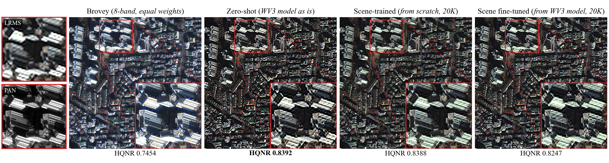

**춘천 도시 · 호수 · 산지 (도시 · 혼합)** — 규칙적인 무늬의 대형 유리 지붕. 제로샷은 PAN 에 없는 둥근 덩어리 무늬(격자와 지붕 무늬의 간섭), 단독 학습 · 미세조정과 Brovey 는 PAN 의 지붕 무늬를 그대로 재현(단독 학습 · 미세조정은 대비가 더 강함).

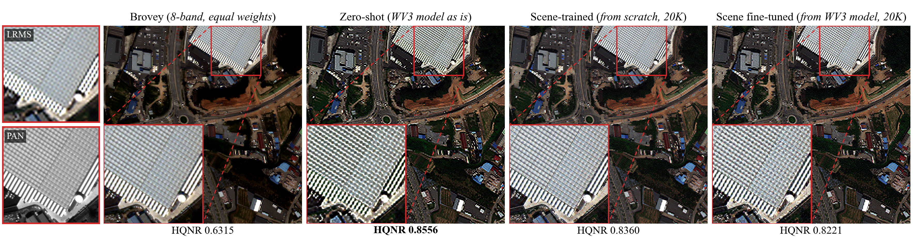

**함평 · 무안 평야 (농촌)** — 비닐하우스와 공장 지붕. 제로샷은 비닐하우스 경계가 계단 모양으로 깨지고 색이 얼룩짐, 단독 학습 · 미세조정은 경계가 곧지만 어두운 땅에 잔점이 많음.

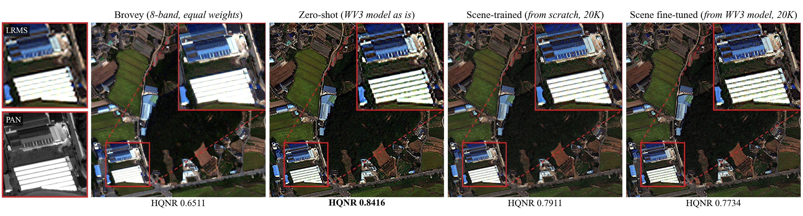

**세종 농산지 · 신도시 주변 (농촌 · 혼합)** — 색 지붕 주택 단지. 제로샷은 지붕 경계가 들쭉날쭉하고 주변이 검게 테두리짐, 단독 학습 · 미세조정은 지붕 모양 · 색이 LRMS · PAN 과 가장 잘 맞고 도로 · 맨땅이 거침, Brovey 는 지붕 색이 부드럽게 번짐.

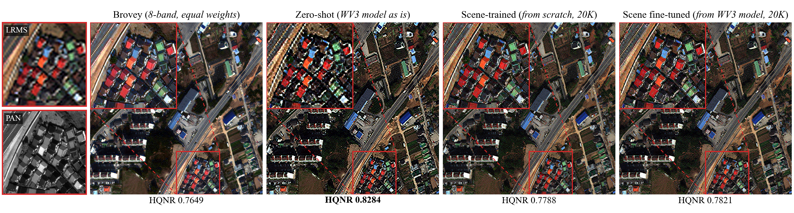

**진주 · 사천 (박무)** — 주택가와 운동장. 제로샷은 운동장 같은 평탄면에 격자 무늬가 뚜렷(다섯 씬 중 가장 강함), 단독 학습 · 미세조정은 무늬 없이 선명하나 입자감, Brovey 는 매끈하고 경계가 PAN 과 가장 비슷.

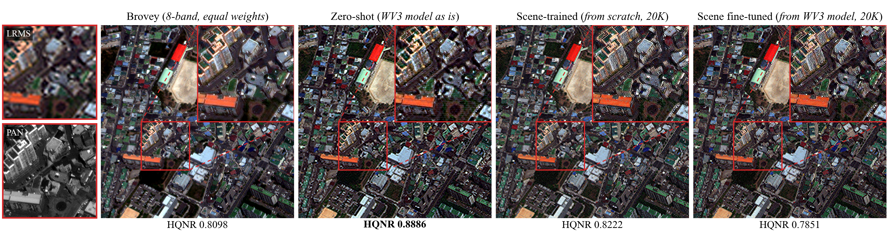

### 차량 비교

- **영역 선택:** 감사 구역 타일을 PAN 에서 찾은 차량 크기 물체 수(식생 제외, 평탄한 포장면 위의 면적 6–50 화소 밝은 · 어두운 점)로 정렬하고, 상위 30개 타일의 PAN 만 보고 차량이 모인 곳을 골라 2×2 타일(512×512 PAN 화소, 약 240 m) 영역과 확대 상자를 정함. 방법별 결과는 보지 않음. 씬마다 2곳씩 10곳 — 첫 묶음은 주차장 4곳 · 고속도로 1곳(함평 · 무안은 주차장이 없음), 두 번째 묶음은 첫 묶음과 겹치지 않는 도로 주행 차량 · 버스 주차장 · 마을 도로 · 버스 차고지 · 고속도로 주행 차량.
- **그림 구성:** 위 정성 비교와 같은 형식(확대 2배, 같은 밝기 범위 규칙, 패널 아래 영역 HQNR). 근접 확대 그림은 각 확대 상자 가운데 64×64 PAN 화소(약 30 m)를 5배(화소 복제)로 키운 것 — 차량 한 대가 PAN 에서 약 10×4 화소. 근접 확대에는 HQNR 을 달지 않음(타일보다 작은 범위).

**영역 HQNR** — 굵게는 영역별 최고

| 영역 | Brovey | 제로샷 | 씬 단독 학습 | 씬 미세조정 |
|---|---:|---:|---:|---:|
| 서울 — 대형 노상 주차장 | 0.6794 | 0.8057 | **0.8083** | 0.7982 |
| 춘천 — 건물 앞 주차장 · 간선도로 | 0.6049 | **0.8615** | 0.8465 | 0.8268 |
| 함평 · 무안 — 고속도로 | 0.6408 | **0.8447** | 0.7909 | 0.7662 |
| 세종 — 공터 주차장 · 화물차 | 0.7739 | **0.8196** | 0.7680 | 0.7771 |
| 진주 · 사천 — 아파트 단지 주차장 | 0.8187 | **0.8928** | 0.8225 | 0.7853 |
| 서울 — 간선도로 주행 차량 | 0.6430 | 0.8083 | **0.8235** | 0.8145 |
| 춘천 — 버스 · 승용차 주차장 | 0.5817 | **0.8762** | 0.8602 | 0.8392 |
| 함평 · 무안 — 마을 도로 버스 · 승용차 | 0.7061 | **0.8669** | 0.8432 | 0.8143 |
| 세종 — 버스 · 화물차 차고지 | 0.7421 | **0.8350** | 0.7916 | 0.8047 |
| 진주 · 사천 — 고속도로 주행 차량 | 0.8007 | **0.8718** | 0.7869 | 0.7481 |

- 제로샷이 10곳 중 8곳에서 최고, 서울 두 곳만 씬 단독 학습이 최고. 진주 · 사천 세 곳(정성 비교 영역 포함)과 세종 공터 주차장에서는 Brovey 가 씬 적응 모델 하나 이상보다 높음.

**첫 묶음 — 주차장 4곳 · 고속도로 1곳**

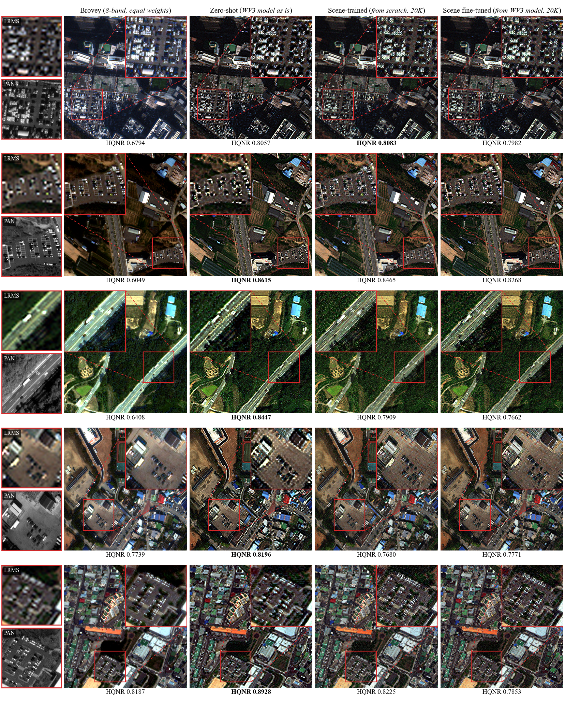

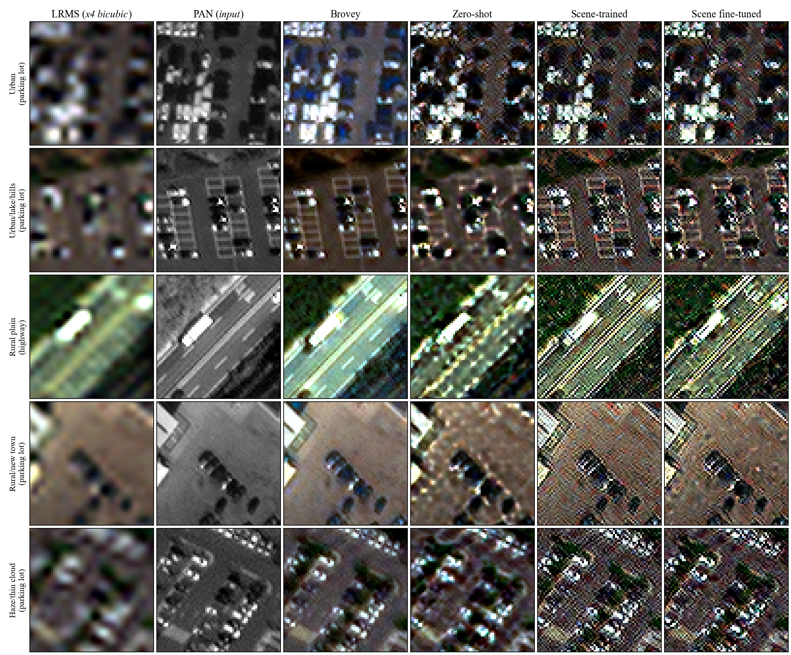

**두 번째 묶음 — 도로 주행 차량 · 버스 주차장 · 마을 도로 · 버스 차고지 · 고속도로 주행 차량**

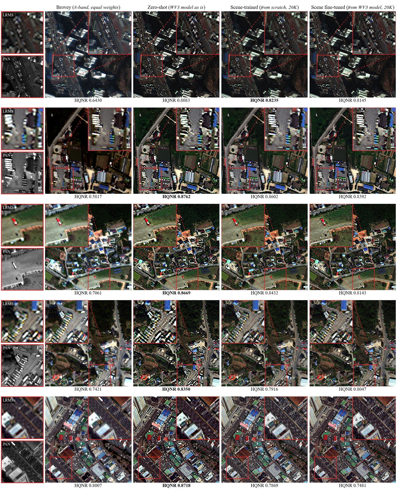

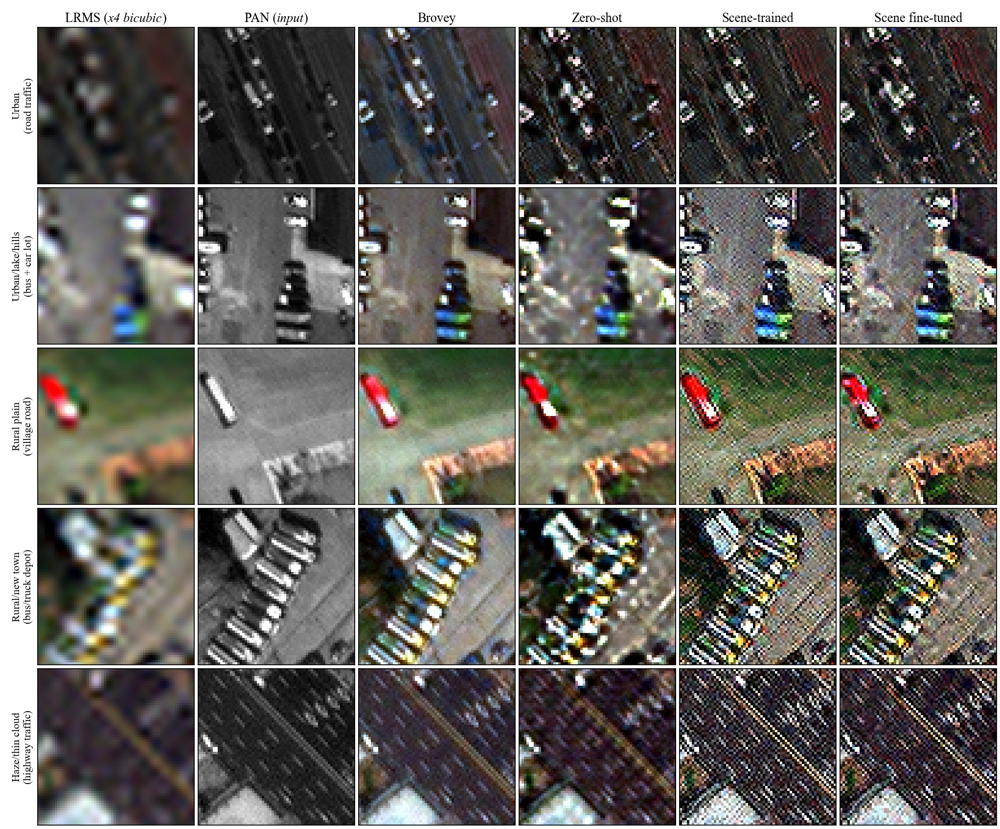

| 방법 | 차량 · 주차선 · 차선 표현 (10곳 공통) |
|---|---|
| Brovey | 차량 윤곽 · 주차선 · 차선이 PAN 과 가장 비슷하고 매끈. 고속도로 차량도 PAN 처럼 작은 점으로 구분됨. 색은 어긋남 — 서울 주차장 차량 · 그림자가 푸르게, 함평 · 무안 고속도로 노면이 청록으로 뜸 |
| 제로샷 | 차량이 둥근 덩어리로 부풀고 밝은 테두리가 생김. 버스 · 화물차 줄이 색 얼룩으로 뭉개짐, 춘천 주차선 · 고속도로 차선이 끊기거나 흐려짐, 세종 · 진주 바닥에 격자 얼룩 |
| 씬 단독 학습 | 차량 윤곽 · 주차선 · 버스 줄이 PAN 처럼 날카롭게 살아남. 대신 화면 전체에 화소 단위 잡음과 붉은 · 청록 점, 차량 둘레에 밝은 테두리. 고속도로에서는 차선 방향 줄무늬가 여러 겹 생겨(진주 · 사천에서 가장 심함) 주행 차량이 줄무늬에 묻힘 |
| 씬 미세조정 | 씬 단독 학습과 거의 같음 |

- 차량 같은 작은 물체에서 제로샷은 형태를 잃고, 씬 적응은 형태를 살리는 대신 잡음 · 줄무늬를 더함. 영역 HQNR 순서(대체로 제로샷 > 씬 적응 > Brovey)와 차량 형태 보존 순서(Brovey > 씬 적응 > 제로샷)가 일치하지 않음.

### 씬 적응 HQNR 최고 영역 비교

- **영역 선택:** 앞의 비교들과 달리 이번에는 결과 HQNR 로 고름 — 씬마다 2×2 감사 타일 영역(512×512 PAN 화소) 가운데 씬 단독 학습 · 미세조정 중 높은 쪽의 영역 HQNR 이 제로샷 · Brovey 보다 0.0031 이상 높은 곳, 그중 HQNR 이 가장 높은 곳. 확대 상자는 PAN 경계 세기 규칙. 씬 적응에 가장 유리한 영역만 골랐으므로 씬을 대표하지 않음.
- 이런 영역의 비율(2×2 영역 기준): 서울 31% · 춘천 17% · 진주 · 사천 22% · 세종 2% · 함평 · 무안 1%. 씬 적응이 이기는 타일의 공통 특성(경계 세기 · 밝기 · 식생 지수와의 상관)은 씬마다 방향이 달라 찾지 못함.

**영역 원 해상도 지표** — HQNR / D_λ(분광 왜곡) / D_s(공간 왜곡), 굵게는 영역별 최고(HQNR 은 최대, D_λ · D_s 는 최소)

| 영역 | Brovey | 제로샷 | 씬 단독 학습 | 씬 미세조정 | 단독 학습 − 제로샷 HQNR |
|---|---|---|---|---|---:|
| 서울 — 밀집 주택가 | 0.7719 / 0.1777 / **0.0612** | 0.8602 / **0.0234** / 0.1192 | **0.8677** / 0.0454 / 0.0910 | 0.8487 / 0.0373 / 0.1184 | +0.0075 |
| 춘천 — 비닐하우스 · 하천변 공장 | 0.5687 / 0.3391 / 0.1510 | 0.8459 / 0.0821 / **0.0779** | **0.8519** / **0.0716** / 0.0822 | 0.8329 / 0.0869 / 0.0875 | +0.0060 |
| 함평 · 무안 — 산림 | 0.5425 / 0.3714 / **0.1373** | 0.7101 / 0.1690 / 0.1454 | **0.7201** / **0.1450** / 0.1578 | 0.6899 / 0.1810 / 0.1575 | +0.0100 |
| 세종 — 하천 · 제방 · 맨땅 | 0.4394 / 0.3701 / 0.3047 | 0.7187 / 0.1909 / 0.1128 | **0.7354** / **0.1791** / **0.1044** | 0.6263 / 0.2792 / 0.1344 | +0.0167 |
| 진주 · 사천 — 태양광 패널 · 산지 도로 | 0.5546 / 0.3367 / 0.1668 | 0.8014 / 0.0937 / **0.1161** | **0.8073** / **0.0713** / 0.1307 | 0.7931 / 0.0847 / 0.1335 | +0.0059 |

- 다섯 곳 모두 1위는 씬 단독 학습이고 우위는 +0.006 ~ +0.017. 씬 미세조정은 다섯 곳 모두 제로샷보다 낮음 — 씬 단위에서도 미세조정이 단독 학습보다 HQNR 이 낮았던 것과 같은 방향.
- 단독 학습의 우위는 대부분 분광 쪽(D_λ)에서 나옴 — 춘천 · 함평 · 진주는 D_λ 가 제로샷보다 낮고 D_s 는 오히려 높음, 서울은 D_s 만 낮음, 세종은 둘 다 낮음. 씬 전체에서 차이가 주로 D_s 에서 났던 것과 다른 양상.
- 그림의 각 결과 아래 한 줄에 영역 HQNR · D_λ · D_s(같은 타일 평균)를 나란히 표기.

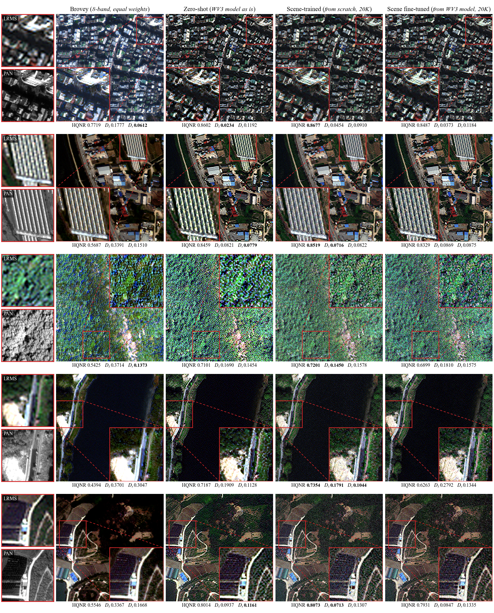

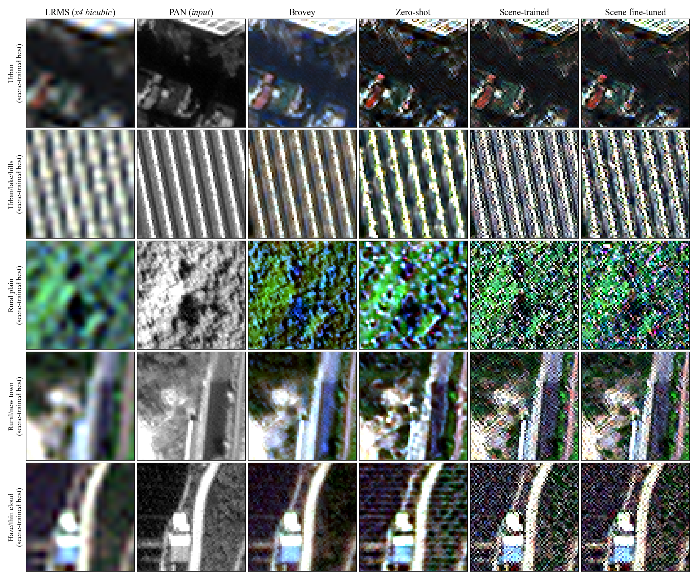

| 영역 | 정성 비교 |
|---|---|
| 서울 — 밀집 주택가 | 신경망 세 방법 모두 지붕 경계 · 색이 비슷. 제로샷은 지붕이 덩어리지고 격자 무늬, 단독 학습 · 미세조정은 경계가 조금 더 가늘지만 그림자 속 화소 잡음. Brovey 는 전체가 푸르게 뜸 |
| 춘천 — 비닐하우스 열 | Brovey 가 PAN 의 줄 간격 · 두께를 가장 그대로 재현. 제로샷은 줄이 굵고 가장자리에 노란 번짐, 단독 학습 · 미세조정은 줄 두께는 PAN 에 가깝지만 줄 위에 화소 단위 잡음 |
| 함평 · 무안 — 산림 | 네 방법 모두 HQNR 이 낮은 어려운 영역. 단독 학습 · 미세조정은 나무 질감 대신 색 점이 뒤섞인 잡음, 제로샷은 초록 덩어리, Brovey 는 파란 기가 섞인 질감 |
| 세종 — 하천 · 제방 | 수면은 네 방법 모두 비슷. 제방 식생 · 맨땅에서 단독 학습 · 미세조정은 잡음, 제로샷은 덩어리. 미세조정만 HQNR 이 크게 낮음(0.626) |
| 진주 · 사천 — 태양광 패널 · 도로 | 제로샷은 어두운 패널 · 식생 위에 가로 줄무늬, 단독 학습 · 미세조정은 화소 잡음, Brovey 가 가장 매끈하고 PAN 과 비슷 |

- 씬 적응이 HQNR 로 이긴 영역에서도 화면의 인상은 앞 비교와 같음 — 제로샷은 덩어리 · 격자, 씬 적응은 화소 잡음, 모양은 Brovey 가 PAN 에 가장 가까움. 0.006 ~ 0.017 의 HQNR 우위는 눈에 띄는 화질 차이로 이어지지 않음.

### 주기 무늬 · 고주파 진단

정성 비교의 격자 무늬와 입자감을 수치로 확인. 감사 구역 원 해상도 타일 전부에 대해 출력 8밴드 평균 밝기의 2차원 주파수 성분을 계산.

- **4화소 주기 성분 비율:** MS 화소 격자 주기(PAN 4화소)의 성분 크기 ÷ 같은 주파수 반경의 전형적 크기. 무늬가 없으면 약 1. 같은 위치의 원래 PAN 을 기준으로 함께 계산.
- **2화소 주기 성분 비율:** 같은 방식으로 가로 · 세로 2화소 주기(가장 높은 주파수) 위치를 잼.
- **고주파 배수:** 0.30–0.45 주기/화소 구간의 성분 크기(저주파 구간으로 정규화)를 PAN 의 같은 값으로 나눈 것. 1 이면 PAN 과 같은 세기.

| 씬 | 4화소 주기 성분 비율 (타일 중앙값) — PAN · Brovey · 제로샷 · 단독 학습 · 미세조정 | 2화소 주기 성분 비율 — PAN · 제로샷 · 단독 학습 · 미세조정 | 고주파 배수 — 제로샷 · 단독 학습 · 미세조정 |
|---|---|---|---|
| 서울 도심 | 1.13 · 1.12 · **6.31** · 2.44 · 3.17 | 0.58 · 5.74 · **30.41** · 6.69 | 2.93 · 5.31 · 4.70 |
| 춘천 | 0.99 · 0.99 · **9.05** · 1.54 · 4.31 | 0.97 · **377.87** · 0.59 · 2.93 | 0.51 · 5.61 · 4.61 |
| 함평 · 무안 | 1.48 · 1.47 · **22.85** · 2.44 · 8.57 | 0.74 · **110.06** · 0.72 · 1.62 | 0.41 · 5.93 · 6.33 |
| 세종 | 1.08 · 1.08 · **28.74** · 2.18 · 3.88 | 0.79 · **238.54** · 0.96 · 1.33 | 0.56 · 7.14 · 5.57 |
| 진주 · 사천(박무) | 1.11 · 1.11 · **439.49** · 3.30 · 1.95 | 2.27 · **1654.02** · 2.60 · 1.87 | 0.54 · 5.61 · 6.53 |

- 제로샷의 4화소 주기 성분은 PAN 의 약 6–400배 — 정성 비교의 격자 무늬와 일치. 그 배음인 2화소 주기도 PAN 의 약 10–730배. 씬 적응으로 PAN 의 1.6–3.0배(단독 학습) · 1.8–5.8배(미세조정)까지 줄고, 미세조정은 박무 씬을 빼면 단독 학습보다 무늬가 더 남음 — WV3 모델에서 이어받은 것으로 보임.
- 씬 적응 두 방법은 0.30–0.45 주기/화소 성분이 PAN 의 4.6–7.1배 — 정성 비교 · 차량 비교의 입자감, 원 해상도 D_s 상승과 같은 방향. 특정 주기 없이 넓게 퍼진 고주파이고, 2화소 주기가 두드러진 것은 서울 씬(단독 학습 PAN 의 약 50배 · 미세조정 약 12배)뿐. 제로샷은 서울 씬을 빼면 PAN 보다 약함(0.4–0.6배).
- Brovey 의 8밴드 평균 밝기는 정의상 PAN 과 같아 두 값이 일치.

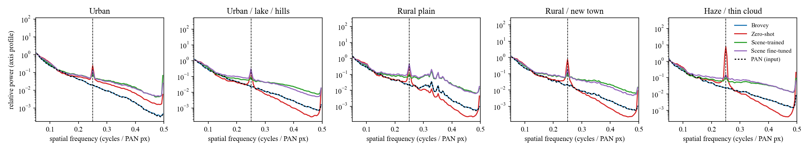

그림 — 씬별 가로 · 세로 축 방향 주파수 성분(저주파 구간으로 정규화, 로그 축). 점선 세로선이 MS 화소 격자 주기(0.25 주기/화소). 검은 점선이 PAN, Brovey 와 겹침.

### 결과 검증 — 무늬 · 잡음이 실제 출력인가

Brovey 와 달리 신경망 결과에만 격자 무늬 · 화소 단위 잡음 · 줄무늬가 보여, 추론 · 타일 결합 · 그림 표시 과정에서 생긴 것인지 확인.

| 확인 | 방법 | 결과 |
|---|---|---|
| 저장 결과 재현 | 같은 체크포인트 · 같은 입력으로 다시 추론(서울 · 진주 영역 타일 4개씩, 신경망 세 방법) | 저장 결과와 차이 **0 DN** |
| 타일 결합 영향 | 512×512 영역을 타일로 나누지 않고 한 번에 추론 | 타일 결합 결과와 최대 **0.007 DN** 차이 |
| 입력 저주파 PAN | 원 PAN 에서 다시 계산 | 저장된 입력과 차이 0 |
| 그림 표시 | 이전 그림은 Lanczos 리샘플링으로 표시 → 원 화소 1:1(리샘플링 없음)로 다시 그림 | 무늬 · 잡음 그대로 |

→ 무늬 · 잡음은 모델 출력 자체. 원인을 보려고 고주파 이득(출력 8밴드 평균 밝기의 고주파가 기준 영상 고주파의 몇 배인지, 저주파로 밝기 척도를 맞춘 뒤 회귀)을 학습 조건(축소 해상도, 기준 = 정답)과 원 해상도(기준 = PAN)에서 비교. 씬마다 감사 타일 64개의 중앙값.

| 방법 | 축소 해상도 고주파 이득 (정답 대비) | 원 해상도 고주파 이득 (PAN 대비) | 원 해상도 PAN 과 무관한 고주파 (PAN 고주파 대비) |
|---|---|---|---|
| Brovey | 0.18–0.35 | 1.00 | 0.00–0.04 |
| 제로샷 | 0.19–0.71 | 0.83–1.86 | 0.69–1.48 |
| 씬 단독 학습 | **0.86–0.95** | **2.49–4.91** | 1.87–3.41 |
| 씬 미세조정 | **0.86–0.94** | **2.25–5.02** | 1.99–3.58 |
| 참고: WV3 기준 모델을 WV3 원 해상도 테스트 20장에 | — | 0.79 | 0.83 |
| 참고: 논문 WV3 최종 모델, 같은 20장 | — | 0.78 | 0.73 |

- **학습용 축소 PAN 이 정답보다 많이 흐림.** 축소 PAN 의 고주파는 정답(원 MS 밝기)의 0.30–0.34배(다섯 씬). 축소에 쓴 Gaussian 근사가 PAN 에 Nyquist 이득 0.11, MS 에 0.35 를 적용하기 때문(측정한 센서 해상도 특성이 아님). 그래서 축소 해상도 Brovey 는 정답 고주파의 18–35% 만 얻음.
- **씬 적응 모델은 이 차이를 메우려고 PAN 고주파를 약 3배 키우도록 학습.** 학습 조건에서는 정답 고주파의 86–95% 를 복원하고 결과도 깨끗함(아래 그림 위 줄). 같은 증폭이 원래 선명한 원 해상도 PAN 에 걸리면 PAN 대비 2.3–5.0배 고주파가 들어가 PAN 의 잡음 · 화소 단위 성분까지 커짐(아래 줄) — 정성 비교의 입자감 · 줄무늬, 원 해상도 D_s 상승의 원인.
- **제로샷의 4화소 격자는 WV3 에서도 약하게 있음.** 같은 WV3 기준 모델을 WV3 원 해상도 테스트에 적용하면 4화소 주기 성분이 PAN 의 약 5배, 논문 WV3 최종 모델도 약 3.7배 — 축소 해상도로 학습한 모델의 원 해상도 출력에 공통으로 있는 성분. WV2 씬에서는 PAN 의 약 6–400배로 커짐(원인은 분리하지 않음). 고주파 이득은 0.83–1.86 으로 씬 적응보다 작음(1 을 크게 넘는 것은 서울 씬 1.86 뿐).
- **Brovey 는 출력 밝기의 고주파가 정의상 PAN 그대로(이득 1.00)라 이런 무늬가 생기지 않음.** 대신 축소 해상도에서는 흐리고 색이 어긋남.
- 정리하면 Brovey 대비 신경망 결과의 무늬 · 잡음은 실제 결과이고, 씬 적응 쪽의 고주파 과다는 학습용 축소 방식(축소 PAN 을 얼마나 흐리게 만드는지)에서 비롯됨. 축소 방식을 바꾸거나 고주파 증폭을 제한하면 달라질 수 있는 부분.

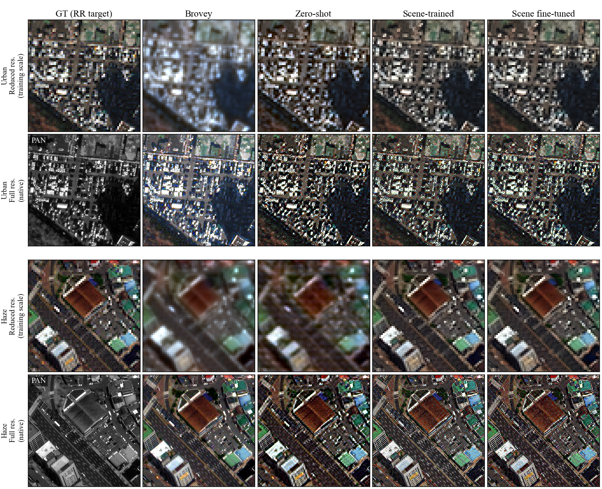

그림 — 서울 주차장 · 진주 고속도로 타일. 위 줄은 학습 조건(축소 해상도 64×64, 4배 화소 복제), 아래 줄은 같은 땅의 원 해상도(256×256, 1:1). 첫 칸은 각각 정답(원 MS) · 원 PAN.

### HQNR 해석 — 측정은 맞는가, 무엇을 보는가

정성 비교에서 제로샷은 격자 무늬 · 덩어리 · 계단 경계가 가장 심한데 HQNR 은 대부분 가장 높아, 측정 자체와 지표의 성질을 확인. 다섯 씬에서 감사 타일 16개씩(80개), 평가와 같은 입력(주변 128 화소 문맥 포함)을 다시 만들어 계산.

**측정 검증**

- 다시 계산한 HQNR 이 저장값과 최대 0.00015 차이(Brovey 는 필터용 주변 문맥만 근사, 신경망은 차이 0).
- 같은 창 · 같은 식을 저장소의 원 해상도 평가 구현(벤치마크에서 공개 모델의 논문 수치를 재현한 구현)과 DLPan 툴박스 공식 보간으로 다시 계산 — HQNR · D_λ · D_s 모두 완전히 같음.
- 식은 DLPan 툴박스의 HQNR 그대로 — D_λ = 1 − Q8(4배 확대 MS, WV2 MTF 저역 필터를 건 출력), D_s = 밴드별 |UQI(출력, PAN) − UQI(4배 확대 MS, 저해상도 PAN)| 평균, 32×32 창. 이번 평가는 타일(256×256) 단위 평균이라 절대값은 벤치마크 결과표와 비교 불가.

**민감도 실험** — 출력의 한 성질만 바꿔 HQNR 을 다시 잼(80타일 평균, 기준값은 이 표본의 값이라 씬 전체 평균과 조금 다름)

| 조작 | 4화소 주기 성분 (씬별 타일 중앙값) | HQNR |
|---|---|---|
| 제로샷 그대로 | 5–341 | 0.7691 |
| 제로샷에서 4화소 주기 성분만 제거 | 0.2–1.2 | 0.7701 (+0.0010; 박무 씬만 +0.004, 나머지 ±0.001 이하) |
| Brovey 그대로 | 0.7–1.4 | 0.5070 |
| Brovey 에 제로샷의 주기 성분을 더함 | 17–683 | 0.5184 (+0.0114; 박무 씬 +0.054, 나머지 +0.001 이하) |
| 제로샷 잔차 2배 | — | 0.5939 |
| 씬 단독 학습 잔차 1 · 0.75 · 0.5 · 0.35배 | — | 0.7466 · 0.7875 · 0.8244 · 0.8333 |
| 씬 미세조정 잔차 1 · 0.75 · 0.5 · 0.35배 | — | 0.7130 · 0.7594 · 0.8040 · 0.8207 |

잔차 배율 = 출력에서 4배 확대 MS 를 뺀 부분(모델이 더한 고주파 · 색 보정)에 곱한 값.

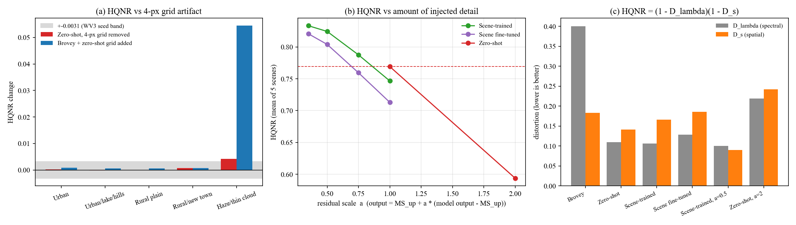

그림 — (a) 격자 제거 · 주입에 따른 HQNR 변화(회색 띠는 WV3 에서 잰 seed 판정 기준 ±0.0031). (b) 잔차 배율에 따른 HQNR(빨간 점선은 제로샷). (c) D_λ · D_s 분해.

**제로샷 HQNR 이 높은 이유**

- **D_λ 는 격자를 볼 수 없음.** D_λ 는 출력에 MTF 저역 필터(MS 의 가장 높은 주파수에서 통과율 0.35)를 건 뒤 비교. 4화소 주기는 그 두 배 주파수라 통과율이 약 1.5%, 2화소 주기는 사실상 0 — 격자 제거 전후 D_λ 0.1092 → 0.1092 로 같음.
- **D_s 는 고주파의 양에 민감하고 모양에는 둔감.** 32×32 창마다 "밴드가 PAN 을 얼마나 닮았나"를 한 값(UQI)으로 요약해, 그 값이 원 해상도와 저해상도에서 같은지만 봄. PAN 을 지나치게 많이 넣거나(씬 적응) 너무 그대로 따르면(Brovey) 커지지만, PAN 과 무관한 격자 · 덩어리 · 계단 경계는 창 전체 분산에 비해 작아 거의 반영되지 않고, 오히려 값을 기준 쪽으로 옮기기도 함(박무 씬 Brovey + 격자에서 HQNR 상승).
- **결과적으로 순위는 주입량 순서.** 제로샷의 고주파 이득은 PAN 의 0.8–1.9배로 중간이라 D_s 가 가장 작음(0.141). 씬 적응은 2.2–5.0배로 과다 주입이라 D_s 0.166 · 0.186. D_λ 는 제로샷 0.109 · 단독 학습 0.106 으로 거의 같아, HQNR 차이는 대부분 D_s 에서 나옴. 씬 단독 학습 출력의 잔차를 절반으로 줄이면 D_s 가 0.090 으로 떨어져 HQNR 이 제로샷을 넘음.
- **Brovey 는 D_λ 가 매우 커서(0.401) 최하위.** 8밴드 균등 가중이라 밴드 간 관계가 크게 어긋남.

**의미** — 이번 HQNR 은 정확히 계산됐지만, 이 데이터에서는 화질 결함(격자 · 덩어리 · 잡음의 모양)보다 주입한 고주파의 양을 주로 반영. 제로샷의 HQNR 우위는 "격자가 있어도 주입량이 적당해서"이고, 씬 적응의 열세는 "모양은 낫지만 주입량이 과해서". 방법을 고를 때는 HQNR 과 함께 주기 성분 · 고주파 이득 · 정성 비교를 같이 봐야 함.

### 적응 학습 곡선

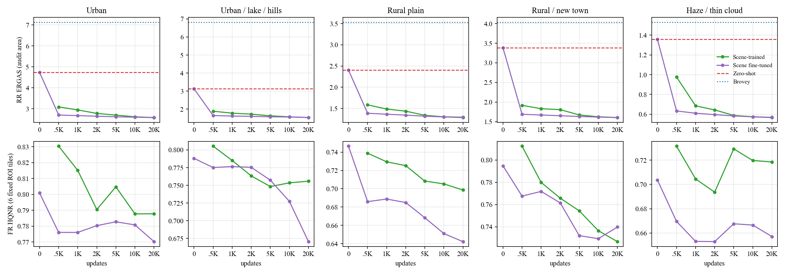

그림 — 위: 감사 구역 전체의 축소 해상도 ERGAS(빨간 점선 제로샷, 파란 점선 Brovey). 아래: 고정 영역 원 해상도 타일 6개의 HQNR(진단용). 단독 학습의 0 반복은 4배 확대 MS 와 같은 초기 상태라 생략, 미세조정의 0 반복은 제로샷과 같음.

- **미세조정은 첫 500 반복에 축소 해상도 개선의 91–95% 도달**(제로샷 → 20,000 반복 개선 폭 기준). 단독 학습은 같은 수준까지 5,000 반복 필요(다섯 씬 모두). 20,000 반복에서 둘은 같아짐.
- 검증 구역 L1 은 두 방법 모두 20,000 반복까지 조금씩 계속 감소.
- 고정 영역 원 해상도 HQNR 은 미세조정에서 첫 500 반복부터 다섯 씬 모두 하락(제로샷 대비 −0.013 ~ −0.061), 단독 학습도 대체로 반복이 늘수록 하락. 원 해상도 품질 저하는 학습 초기부터 시작.

### 처리 시간

| 항목 | 시간 | 비고 |
|---|---|---|
| WV3 기준 모델 학습 | 약 1.5시간 | 한 번만 필요, 미세조정 · 제로샷 공통 |
| 씬 적응 학습 (단독 · 미세조정 각각) | 2,707초 ≈ 0.75시간 / 20,000 반복 | 반복당 약 0.135초 → 500 반복 약 1분 · 5,000 반복 약 11분(환산) |
| 원 해상도 타일 추론 — 신경망 | 0.077초 / 타일 | GPU, 정규화 · 전송 · 순전파 포함(주변 128 화소 문맥 포함), 파일 입출력 제외 |
| 원 해상도 타일 추론 — Brovey | 0.030초 / 타일 | CPU 1스레드, 파일 입출력 제외 |
| 학습 중 진단 평가 (실험 부가 비용) | 4–6분 / 모델 | 서비스 처리 시간에는 포함되지 않음 |

## 6. 용어 정의

| 용어 | 뜻 |
|---|---|
| PAN · MS · HRMS | 고해상도 흑백 영상 · 저해상도 다중분광 영상 · 둘을 합쳐 만든 고해상도 다중분광 영상 |
| LRMS | 그림 왼쪽의 저해상도 MS 를 PAN 크기로 4배 확대(bicubic)한 것. 색 기준으로 봄 |
| WV2 · WV3 | WorldView-2 · WorldView-3 위성. 둘 다 MS 8밴드(연안 · 파랑 · 초록 · 노랑 · 빨강 · 레드엣지 · 근적외 2개) + PAN, 해상도 비 4 |
| 축소 해상도 평가 · 원 해상도 평가 | PAN · MS 를 4배 줄인 입력으로 복원해 원래 MS(정답)와 비교 · 실제 해상도 입력으로 복원해 정답 없이 평가 |
| 근사 Gaussian 축소 | 축소 해상도 입력을 만드는 흐림 + 4배 솎아내기. 실제 센서의 해상도 특성을 측정한 값이 아닌 근사 |
| HQNR · D_λ · D_s | 원 해상도 품질 지표 = (1 − D_λ)(1 − D_s). D_λ 분광 왜곡(입력 MS 의 밴드 간 관계와 어긋남) · D_s 공간 왜곡(입력 PAN 과의 공간 구조 어긋남), 둘 다 낮을수록 좋음 |
| SCC · ERGAS · SAM · PSNR · Q8 | 축소 해상도 지표 — 정답과의 공간 상관(높을수록 좋음) · 상대 전역 오차(낮을수록 좋음) · 분광 각도(낮을수록 좋음) · 신호 대 잡음비(높을수록 좋음) · 8밴드 품질 지수(높을수록 좋음) |
| PAN 구조 상관 · 재투영 SAM | 원 해상도 보조 진단 — 출력 경계와 PAN 경계의 상관 · 출력을 MS 해상도로 줄여 원래 MS 와 비교한 분광 각도 |
| 감사 구역 · 검증 구역 · 학습 구역 | 씬을 1,024 MS 화소 블록으로 나눠 배정한 구역. 학습 구역만 학습에, 검증 구역은 보조 시점 선택에, 감사 구역은 평가에만 사용 |
| 조각 · 타일 | 축소 해상도 학습 · 평가 단위(정답 64×64 MS 화소) · 같은 위치의 원 해상도 평가 단위(256×256 PAN 화소) |
| WV3 기준 모델 | 공개 WV3 학습 세트로만 학습한 저·고주파 PAN 입력 U-Net. 제로샷 적용과 미세조정의 출발점 |
| 제로샷 | WV3 기준 모델을 추가 학습 없이 WV2 씬에 그대로 적용 |
| 씬 단독 학습 | 같은 구조를 무작위 초기값에서 그 씬의 학습 구역만으로 학습 |
| 씬 미세조정 | WV3 기준 모델에서 출발해 그 씬의 학습 구역으로 이어 학습(모든 층) |
| 8밴드 Brovey | 비학습 전통 방법 — 각 밴드에 PAN ÷ (8밴드 평균) 비율을 곱함. 밴드 가중치는 모두 1/8(최적화한 WV2 가중치 아님), GDAL 구현 |
| 저·고주파 PAN 입력 | U-Net 입력 = 4배 확대한 MS + PAN + 그 저주파 성분(흐린 PAN) + 고주파 성분(PAN − 흐린 PAN), 11채널 |
| 폭 · 깊이 | U-Net 첫 단계의 채널 수 · 해상도 단계별 블록 수 |
| 정합 모듈 · KD · Teacher | 이전 실험의 구성 요소(PAN 이동량 예측 모듈 · 먼저 학습한 모델 출력을 보조 정답으로 쓰는 지식 증류). 이번 실험 모델에는 없음 |
| 반복 | 최적화 1회(배치 48) |
| seed | 초기 가중치 · 데이터 순서를 정하는 난수 초기값 |
| 4화소 주기 성분 비율 | 출력 밝기의 주파수 성분 중 MS 화소 격자 주기(PAN 4화소) 위치의 크기 ÷ 같은 주파수 반경의 전형적 크기(중앙값). 격자 무늬가 없으면 약 1 |
| 2화소 주기 성분 비율 | 같은 방식으로 가로 · 세로 2화소 주기(가장 높은 주파수) 위치의 크기 ÷ 가장 바깥 고리의 전형적 크기 |
| 고주파 배수 | 0.30–0.45 주기/화소 성분 크기(0.04–0.08 구간으로 정규화)를 PAN 의 같은 값으로 나눈 것 |
| 고주파 이득 | 출력 8밴드 평균 밝기의 고주파(σ1 Gaussian 을 뺀 성분)를 기준 영상(축소 해상도는 정답, 원 해상도는 PAN) 고주파에 회귀한 기울기. 저주파(σ4)로 밝기 척도를 먼저 맞춤. 1 이면 기준과 같은 세기 |
| UQI | 두 영상 창의 유사도 지수 — 상관 · 밝기 · 대비를 곱한 값(1 이 같음). D_s 는 이것을 32×32 창마다 계산 |
| 잔차 배율 | 출력 = 4배 확대 MS + 배율 × (원래 출력 − 4배 확대 MS). 모델이 더한 고주파 · 색 보정의 양만 바꾸는 조작 |
| PAN 과 무관한 고주파 | 위 회귀에서 남은 고주파의 크기 ÷ PAN 고주파 크기. 클수록 PAN 에 없는 무늬 · 잡음이 많음 |
| Nyquist 이득 | 영상이 표현할 수 있는 가장 높은 주파수에서 남는 신호 비율. 작을수록 흐림 |
| 차량 크기 물체 수 | 차량 영역 후보를 고를 때만 쓴 PAN 기준 수 — 식생(MS 로 판단)을 빼고, 배경이 평탄한 곳에서 배경보다 뚜렷이 밝거나 어두운 면적 6–50 화소 점의 개수 |
| 원래 밝기값 (DN) | 위성 영상의 원래 밝기 단위. 여기서는 0–2047(11비트) |

## 7. 실행명(run 이름)

| 코드 | 뜻 |
|---|---|
| `PANPV` | 실용성 검증(practical validation) 실험 묶음 |
| `S1` | 서버 |
| `WV2` · `WV3` | 대상 위성 · 기준 모델 학습 위성 |
| `200014103764_01` | 서울 도심 · 한강 (도시) |
| `200014103758_01` | 춘천 도시 · 호수 · 산지 (도시 · 혼합) |
| `200014103802_01` | 함평 · 무안 평야 (농촌) |
| `200014103714_01` | 세종 농산지 · 신도시 주변 (농촌 · 혼합) |
| `200014103525_01` | 진주 · 사천 박무 · 얇은 구름 (박무) |
| `BROVEY8` | 8밴드 Brovey |
| `ZS_WV3` | 제로샷 |
| `SC_SCENE` | 씬 단독 학습 |
| `FT_WV3_SCENE` | 씬 미세조정 |
| `EXACT20K` · `BEST_RRVAL_TO_20K` | 20,000 반복 종료 시점 · 검증 구역 L1 최소 시점 |
| `R01` · `SE261002` | 1회차 · seed 261002 |
| `DONOR_WV3_ONLY` · `SE271001` · `EXACT50000` | WV3 기준 모델 · seed 271001 · 50,000 반복 종료 시점 |
| `W104_D122` | 폭 104 · 깊이 [1,2,2] |
| `PLH` | 저·고주파 PAN 입력 |
| `NOA` · `NOKD` | 정합 모듈 없음 · KD 없음 |
| `v1` | 설정 · 작업 버전 |

| 실험 | 실행명 · 작업 이름 | 서버 | 상태 |
|---|---|---|---|
| ①–⑤ | 실험 묶음 `PANPV_S1_WV2_20261004_R1` | s1 | 실행 |
| ① | `PANPV_DONOR_WV3_ONLY_W104_D122_PLH_NOA_NOKD_SE271001_EXACT50000_v1` | s1 | 실행 |
| ② | `<씬>_BROVEY8` (5개 씬) | s1 | 실행 |
| ③ | `<씬>_ZS_WV3` (5개 씬) | s1 | 실행 |
| ④ | `PV_S1_<씬>_SC_SCENE_R01_SE261002` (5개) — 평가 `<씬>_SC_SCENE_EXACT20K`, 서울 씬만 `200014103764_01_SC_SCENE_BEST_RRVAL_TO_20K` 추가 | s1 | 실행 |
| ⑤ | `PV_S1_<씬>_FT_WV3_SCENE_R01_SE261002` (5개) — 평가 `<씬>_FT_WV3_SCENE_EXACT20K` | s1 | 실행 |
