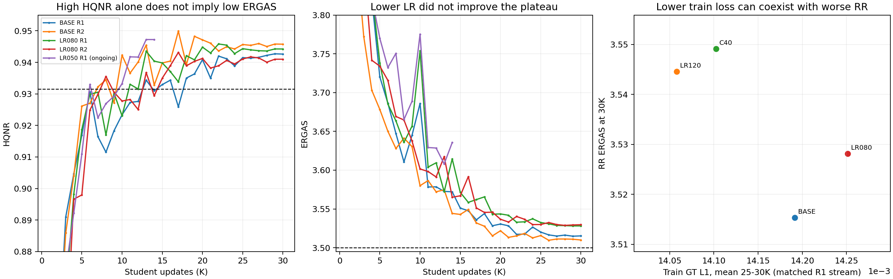

# 2026-10-30 QB 정체 구간 재분석과 s3 후속 설계

## 1. 범위와 현재 판정

2026-10-30 17:04 KST의 s1 로컬 `panda_s1loss9`, `panda_sensor_refine`,
`panda_sensor_focus`, `panda_qb_refit` 원본 평가 및 학습 로그를 읽었다.
Stage 2 **23 run: 완료 20, HQNR 조기 종료 2, 진행 중 1**,
같은 상태의 RR/FR임이 확인된 **647 checkpoint 평가**가 근거다.
이 숫자는 위 네 캠페인의 범위이며, 모든 과거 QB 실험을 뜻하지 않는다.

QB 목표 **HQNR≥0.9315 및 ERGAS≤3.5**의 동시 달성은 이 범위에서 0개다.
최선은 기존 `QB_BASE R2 @26K`: **H=.945383746, E=3.509656381, P=38.449570**이다.
남은 ERGAS 차이는 .009656, 목표 대비 약 .276%다. HQNR 여유는 .013884다.
현재 병목은 HQNR 최대화 자체보다, 이를 유지하며 RR 복원 오차를 낮추는 것이다.

| run | 상태 / 대표 step | HQNR | ERGAS | PSNR |
|---|---|---:|---:|---:|
| BASE R1 (`QB_A200_E030`) | 완료 /29K | .942698 | 3.514885 | 38.435595 |
| BASE R2 | 완료 /26K | .945384 | 3.509656 | 38.449570 |
| 새 LR080 R1 | 완료 /30K | .944229 | 3.528125 | 38.402746 |
| 새 LR080 R2 | 완료 /28K | .940048 | 3.528824 | 38.409789 |
| 새 LR050 R1 | 진행 중 /13K 대표 | .947231 | 3.608067 | 38.214574 |

LR050은 마지막 평가 14K에서 H=.947219/E=3.635583이다.
13K 대표를 30K 완료 성능으로 읽으면 안 된다. 초기 HQNR이 높다고 목표에 더 가깝다는 근거도 없다.
현재 QB 후속 10 run 중 2개 완료, 1개 진행, 7개 미시작이다.
남은 LR050 R2, C25 R1/R2, AG000 R1/R2, G025 R1/R2는 기존 등록 큐에 있다.

## 2. LR080의 악화는 한 장의 이상치나 대표 선정 효과가 아니다

아래 비교는 대표 checkpoint끼리가 아니라 **같은 30K**, 같은 replica의 기준 모델과 비교했다.
같은 frozen Aligner state SHA이며, RR 20장의 예측 shift 최대 차이는 **정확히 0**이다.

| LR080 − BASE @30K | R1 | R2 |
|---|---:|---:|
| ΔERGAS | +.012834 | +.019671 |
| ΔPSNR | −.031884 | −.040210 |
| ΔHQNR | +.001614 | −.004770 |
| ΔD_s | −.005268 | +.001346 |
| ΔD_lambda | +.003647 | +.003543 |
| ERGAS가 악화된 RR 장면 | 16/20 | 17/20 |
| 장면별 ΔERGAS 중앙값 | +.013080 | +.014352 |
| scene 0 제외 평균 ΔERGAS | +.015934 | +.012582 |

25–30K 평균 ERGAS도 LR080 R1/R2 각각 3.529488/3.530048이다.
단일 checkpoint 변동으로만 설명하기 어렵다.
R1은 D_s 개선으로 HQNR이 올라갔지만 D_lambda와 ERGAS는 함께 나빠졌다.
즉 높은 HQNR만 보고 “정합·복원 모두 개선”이라고 해석하면 잘못된 판단이 된다.
실제 shift는 같으므로 이 차이는 Aligner의 보정량 변경 때문이 아니다.

## 3. 더 오래 또는 더 크게 학습하면 해결되는가?

이미 `LR120 R1` 및 `C40 R1`가 반대 방향의 실험을 제공한다.
다음은 같은 R1 학습 샘플 흐름의 25–30K 로그 평균 `gt_raw`와 30K 공식 RR이다.
가중치가 다른 loss끼리 비교하지 않고, 가중 전 GT L1을 사용했다.

| 설정 | 학습 GT L1 | BASE 대비 | 30K ERGAS | BASE 대비 |
|---|---:|---:|---:|---:|
| C30 LR100 | .0141914 | — | 3.515291 | — |
| C30 LR080 | .0142514 | +.42% | 3.528125 | +.012834 |
| C30 LR120 | .0140580 | −.94% | 3.544527 | +.029236 |
| C40 LR100 | .0141026 | −.63% | 3.549113 | +.033822 |

LR120와 C40은 각각 RR 17/20장에서 악화됐다. C40의 전체 40K 중 대표도
26K E=3.548152에 그쳤다. **훈련 L1 감소가 RR ERGAS 개선으로 이어지지 않는다.**
LR080은 훈련 L1과 RR가 모두 나빠져, LR을 더 낮추는 방향 역시 자동으로 정당화되지 않는다.

이 패턴은 단순 학습 부족만으로 설명되지 않는다. 훈련/평가 분포 차이,
L1과 ERGAS의 차이, 최적화 경로와 일반화가 모두 가능한 원인이다.
독립 validation 복원 평가 없이 이를 과적합이라고 확정하지 않는다.
LR1.25/1.5e−4 또는 C45를 우선순위 높게 확장할 실증 근거는 현재 약하다.

실제로 현재 Student 평가 레코드는 RR/FR 테스트만 포함하며, 독립 validation 복원 궤적은 찾지 못했다.
Stage 1 selector에는 44K의 Val_ERGAS=3.924386, RRE50=.235295가 있다.
이는 1,905개 validation patch의 별도 집계이므로 RR 테스트 20장 평균이나
Student validation 일반화 변화의 대용으로 사용할 수 없다.

기존 C25는 **일찍 LR을 내리는 별도 가설**을 확인하므로 유지한다.
더 긴 C40의 실패가 짧은 C25의 성공을 보장하지는 않는다.
아직 진행 중인 LR050 역시 완료 전 실패로 단정하거나 중단 근거로 사용하지 않는다.

## 4. 3.51은 데이터 자체의 불가피한 바닥인가?

같은 **선정된 Stage 1 A200_E030 @44K Teacher**는 다음 성능을 이미 냈다.

| 동일 44K Aligner 사용 | HQNR | D_s | D_lambda | ERGAS | PSNR |
|---|---:|---:|---:|---:|---:|
| Teacher @44K | .759511 | .216289 | .030829 | **3.492595** | 38.484993 |
| Student BASE R2 @26K | **.945384** | **.025819** | .029631 | 3.509656 | 38.449570 |

두 평가의 RR·FR 각각 20장에서 shift 차이는 0이다.
Student는 Teacher 대비 FR HQNR을 **20/20장**에서 높였으나,
RR ERGAS는 **18/20장**에서 높였다(악화). 평균 ΔERGAS는 +.017062다.
따라서 **ERGAS 3.51이 해당 평가 데이터에서 절대 달성할 수 없는 한계는 아니다.**
하지만 Teacher는 HQNR 목표를 크게 미달하므로 이를 동시 목표 달성으로 볼 수 없다.

Student는 correction residual 입력을 통해 원본 PAN 관련 정보를 활용할 수 있고,
Teacher와 학습 기간·입력·가중 loss·sampling 설정도 다르다.
현재 자료만으로 RR 손해 전체를 residual 채널 하나 또는 네트워크 용량 하나에 귀속할 수 없다.
무조건 폭을 키우기보다 기존 weight ablation과 optimizer 가설을 분리해 확인하는 편이 낫다.

참고로 Teacher의 평가상 최소 ERGAS는 37K의 3.487341/H=.755786이다.
이는 진단용 숫자이며 **validation RRE로 선정된 44K donor를 대체하는 기준이 아니다.**
이 44K donor는 역사적 s1 비교의 공통 기준이며, s1의 진행 중 큐에서는 그대로 유지한다.
새 s3 실험에는 이 checkpoint를 강제로 공유하지 않고 §6의 독립 Stage 1 정책을 적용한다.

## 5. 기존 α·γ·폭 실험이 알려주는 것

| 동일 30K, BASE 대비 ΔERGAS | R1 | R2 |
|---|---:|---:|
| α .25→.125, γ .5 유지 | −.004223 | +.012616 |
| α .125 및 γ .25 | −.003787 | +.005028 |
| W112→W128 | −.002381 | +.005338 |
| γ .5→0, α .25 유지 | −.002274 | 미실험 |

작은 개선이 seed 간 반복되지 않았다. W128 R1은 scene 0을 제외하면 개선이 더 크지만,
R2에서는 scene 0을 제외해도 ΔERGAS가 +.002147로 남는다.
한 장의 문제가 모든 실패를 설명하지 않는다.

같은 R1의 25–30K 로그 평균은 다음과 같다. p95는 각 batch의 95분위수를 시간 평균한 값이다.

| 가중 설정 | mean(w) | batch p95(w)의 평균 | mean(d_e) | mean(r_q) 로그 |
|---|---:|---:|---:|---:|
| α.25, γ.5 | 1.217367 | 1.462720 | .499767 | .500067 |
| α.125, γ.5 | 1.154896 | 1.375389 | .499767 | .500067 |
| α.25, γ0 | 1.124942 | 1.195017 | .499767 | 0 (비활성 분기) |

γ0의 r_q=0 로그는 해당 항을 사용하지 않아서 기록된 값이며 discrepancy 전체가 0이라는 뜻이 아니다.
H050의 mean(w)는 약 1.109다.
감소 방향을 여러 번 시험했으나 일관된 이득을 확인하지 못했다.
**α를 더 키우는 방향은 아직 시험하지 않았다는 점에서 진단 가치가 있다.**
그 효과가 좋다는 근거는 없으며, 더 강한 Teacher-error 강조가 오히려 RR를 악화할 수도 있다.
γ까지 동시에 올리지 않아 기존 조건부 discrepancy 성분의 변화와 혼동하지 않는다.
기존 s1의 AG000과 G025가 제거·중간 강도의 비교를 추가로 제공한다.

α.75는 위 s1의 동일 frozen map에서 mean(w)를 약 1.467로 올릴 것으로 계산된다.
새 s3는 독립 Stage 1에서 생성한 map을 사용하므로 이 수치를 그대로 예상값으로 적용하지 않는다.
이 변경은 공간별 강조뿐 아니라 전체 loss·gradient 크기도 바꾼다.
따라서 **순수한 공간 재가중 효과만을 분리하는 실험은 아니다.**
AdamW의 적응적 정규화도 이 혼동을 완전히 제거하지 않는다.
기존 방법의 α 튜닝으로 보고, 학습 gradient와 평균 가중치도 함께 비교해야 한다.

## 6. s3 독립 Stage 1 + Student 8 run 설계와 판단 기준

사용자의 서버별 독립 Stage 1 지시에 따라, **s3에서 QB Stage 1을 처음부터 새로 학습**한다.
s1의 기존 Stage 1과 현재 큐는 변경하지 않는다.
s3의 Stage 1은 기존 유력 조건인 **λ_abs=2, λ_epsilon=.03, ε 반경 3px, 50K**, seed **261016301**이다.
원본 s1 checkpoint·Teacher·Aligner를 가져와 초기화하지 않는다.

50K 등록 구간을 마친 뒤 s3 자체 validation의 **RRE50 → RRE90 → Val_ERGAS → update** 순서로
한 checkpoint를 선정한다. 44K를 미리 고정하거나, s1 donor의 checkpoint SHA를 요구하지 않는다.
선정된 같은 checkpoint의 Aligner·Teacher를 동결하고, 해당 pair로 s3의 calibration을 계산한다.
이 **s3 내부 공통 pair**와 calibration을 아래 Student 8개가 사용한다.
Stage 1 하나와 Student 8개를 합쳐 최대 290K update이며 시간 상한은 두지 않는다.

Student 공통 설정은
fresh Student, scale1, corrected PAN + `(corrected PAN − original PAN)` + I_lrms,
W112/UBIL, C30, LR1e−4, β0, γ.5, effective batch48.
Student seeds는 R1=261018101, R2=261018102다.
RGB 구조 참조와 Lanczos4를 유지한다.
현재 Aligner는 Stored LMS 경로다. 논의만 한 공통 interp23 입력으로 바꾼 실험과 혼동하지 않는다.
회전 loss/TTA/SWA/soft loss/새 밴드 loss/새 아키텍처는 추가하지 않는다.

| 순서 | 설정 | replicas | 다른 값 | 확인하는 가설 |
|---|---|---|---|---|
| 1–2 | QB3_CONTROL | R1, R2 | WD=.01, α=.25 | s3 자체 Stage 1을 포함한 기준 성능 |
| 3–4 | QB3_WD000 | R1, R2 | **weight decay=0** | 기존 decay 제거 시 최적화·일반화 변화 |
| 5–6 | QB3_WD100 | R1, R2 | **weight decay=.1** | 더 강한 기존 AdamW 정규화의 반대 방향 비교 |
| 7–8 | QB3_A075 | R1, R2 | **α=.75**, WD=.01 | 기존 Teacher-error 강조 증가; γ 고정 |

WD=.001 대신 .0/.1로 넓게 잡는 이유는 AdamW decay 자체의 차이를 실제로 보려는 것이다.
C30 LR1e−4 warmup/cosine의 LR 적분은 약 1.5다.
gradient를 무시한 순수 decay의 누적 배율 근사는 WD=.01에서 exp(−.015)≈.985,
WD=.001에서 .9985, WD=.1에서 .861이다. 실제 파라미터는 gradient도 받으므로
이를 최종 weight norm이나 성능 변화율로 해석하지 않는다.
새 기법이 아니라 이미 사용하는 AdamW의 기존 하이퍼파라미터를 넓게 비교하는 것이다.

기존 **s1의 남은 8 run(진행 중 1 포함)은 유지**하고, s3는 위의 독립 축을 맡긴다.
CONTROL R1/R2마다 Stage 1을 다시 학습하는 것은 아니다. s3에서 독립적으로 학습·선정한
Stage 1 하나를 해당 서버의 8개 Student가 공유하는 구조다.
각 WD·α 효과는 **s3의 CONTROL과 같은 Student seed끼리** 비교한다.
이때 donor checkpoint SHA, calibration, 데이터·sampler·loss·평가 프로토콜은 s3 내부에서 고정한다.

s1↔s3 CONTROL 차이는 Stage 1 seed·선정 checkpoint·calibration·GPU 환경이 함께 달라지는
**전체 학습 절차의 차이**다. 이를 GPU 수치 차이만으로 설명하거나,
s1 baseline 대비 s3 WD/α 효과로 직접 계산해서는 안 된다.
독립 Stage 1에서 여러 Student의 HQNR이 함께 나빠지면 donor 영향도 함께 조사한다.
이를 피하려고 테스트 HQNR이 높은 다른 donor를 임의로 골라 교체하지 않는다.

판정은 기존 규칙에 맞춘 대표 checkpoint뿐 아니라 같은 30K, 25–30K 평균,
20장 paired RR 변화, 두 seed 방향을 함께 본다.
목표는 동일 checkpoint에서 H≥.9315/E≤3.5다.
8·9·10K HQNR이 모두 .90 미만일 때의 기존 QB **Stage 2** 조기 종료 규칙을 유지한다.
Stage 1 Teacher의 낮은 HQNR에는 이 규칙을 적용하지 않는다.
개별 seed의 .00x ERGAS 차이를 확정적 효과로 해석하지 않는다.

이 설계는 원인 분리를 위한 탐색이며 목표 달성 예측이 아니다.
반복적으로 테스트 성능을 참고한 결과이므로 독립 최종 검증과 구분한다.

## 7. 재현 자료

- [계산 코드](assets/2026-10-30_qb-plateau/audit.py)
- [전체 평가·paired scene·Teacher 비교 JSON](assets/2026-10-30_qb-plateau/audit.json)
- [647 checkpoint CSV](assets/2026-10-30_qb-plateau/trajectories.csv)
- [PNG](assets/2026-10-30_qb-plateau/audit.png), [PDF](assets/2026-10-30_qb-plateau/audit.pdf)

이 분석은 read-only였으며 GPU inference·학습·큐 변경·checkpoint 변경을 수행하지 않았다.
평가 JSON의 `weights_saved=false`는 평가 시점의 레코드이며,
실제 checkpoint 보존 여부는 runtime이 이후 작성하는 `models/step_*.pt`와 metadata를 별도 확인해야 한다.
