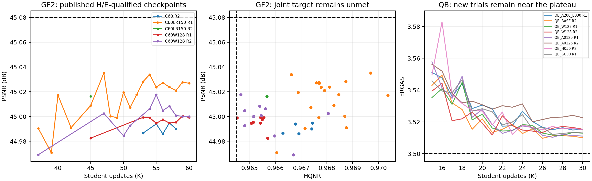

# 2026-10-30 QB·GF2·WV3 결과 분석과 GF2 PSNR 후속

## 1. 근거와 판정 범위

GF2/QB/WV3의 live `pan-cvpr27-new` Sheet와 s1 QB의 원본 evaluation JSON을 확인했다.
GF2 focus 5개는 게시 notes의 candidate_count=60 및 COMPLETED, 통과 step 수와 실제 게시 행 수를 대조했다.
QB focus 6개는 로컬 공식 평가 180개를 확인했다. GF2의 미게시 checkpoint와 scene별 오차는 s3 로컬에서 직접 읽지 않았다.
서로 다른 step의 지표를 조합하지 않고 같은 checkpoint 기준으로 판정했다.

새 GF2 목표: **HQNR≥.9645, ERGAS≤.522, PSNR≥45.08**. QB(.9315/3.5), WV3(.9585/2.040) 유지.
PSNR을 새로 추가했다고 기존 대표 선정(HQNR 충족 중 ERGAS 최소)을 바꾸지는 않는다.

## 2. GF2 — Student 최적화가 실제 개선으로 이어졌다

모두 같은 `RGB_MATURE_U23 @42K` donor, Aligner scale1, Lanczos4,
corrected PAN + correction residual + I_lrms, β0, α.25, γ.5 기준이다.
아래는 각 run의 기존 규칙상 대표 checkpoint이다.

| 설정 | seed | 대표 step | HQNR | ERGAS | PSNR | H/E 동시 통과 step 수 |
|---|---|---:|---:|---:|---:|---:|
| C60, LR1e−4, W112 | R2 | 57K | .967440 | .521483 | 44.994759 | 5/60 |
| **C60, LR1.5e−4, W112** | **R1** | **47K** | **.969704** | **.518120** | **45.035146** | **19/60** |
| C60, LR1.5e−4, W112 | R2 | 45K | .965673 | .519207 | 45.016285 | 1/60 |
| C60, LR1e−4, W128 | R1 | 54K | .964511 | .520682 | 44.999006 | 9/60 |
| C60, LR1e−4, W128 | R2 | 55K | .964654 | .519513 | 45.017655 | 11/60 |

5/5 run이 기존 두 목표를 달성했다. 새 세 목표는 0/5이다.
새 5개 run의 모든 H/E 통과 step이 게시됐음을 확인했으므로 이 캠페인에 미게시된 세 목표 통과는 없다.
과거 공개 GF2 행까지 확인해도 45.08 동시 달성 기록은 없었다.
단, 모든 과거 미게시 checkpoint에 대한 전수 확인을 뜻하지 않는다.

W128 R1의 H/E 충족 중 최고 PSNR은 59K의 45.000374로 대표 54K와 다르다.
PSNR 새 목표에서는 이 차이를 구분해야 한다.

### 2.1 현재 최선의 근거

기존 같은 donor·W112·C60·LR1e−4의 R1은 GF2_LONG @54K,
H=.966800717/E=.524201839/P=44.937777737이었다.
LR만 1.5e−4로 높였을 때 대표 기준 변화는 다음과 같다.

| 동일 seed 비교 | ΔHQNR | ΔERGAS | ΔPSNR |
|---|---:|---:|---:|
| R1 | +.002903 | −.006082 | +.097368 dB |
| R2 | −.001767 | −.002276 | +.021525 dB |

PSNR/ERGAS 개선 방향은 두 seed에서 일치한다. 개선량은 다르고,
선택된 대표 step도 다르므로 고정 step의 효과량이나 통계적 신뢰구간으로 해석하지 않는다.
R2의 H/E 동시 통과가 단 1개인 사실은 HQNR 안정성이 아직 부족함을 보여준다.
H만 통과한 수는 LR150 R1 58/60, R2 21/60이다.

W128 역시 LR100 W112보다 대표 PSNR을 R1 +.061229, R2 +.022895 dB 높였지만,
HQNR은 각각 약 .00229/.00279 낮아졌다. W128 자체를 실패로 닫을 근거는 없다.
다만 LR150 W112보다 자원 비용이 크고 대표 HQNR 여유가 매우 작아, 우선순위는 LR 튜닝이 높다.
폭112→128의 Student 파라미터 증가는 약 30.5%다. 이전 구조 대칭화 가설을 다시 여는 실험은 아니다.

### 2.2 남은 PSNR 차이와 스케줄

최고는 45.035145591로 목표까지 .044854409 dB가 남았다.
`tools/eval_dlpan.py::psnr_global` 및 기존 평가 집계 기준, scene MSE 기하평균 약 1.03% 개선에 해당한다.
가능성을 시험할 만한 크기지만, 튜닝으로 반드시 달성한다는 의미는 아니다.

LR150 R1 공개 H/E 통과 결과:

| step | HQNR | ERGAS | PSNR |
|---:|---:|---:|---:|
| 40K | .970365 | .518820 | 45.017246 |
| 47K | .969704 | .518120 | 45.035146 |
| 54K | .966615 | .518212 | 45.033958 |
| 60K | .967708 | .518750 | 45.026920 |

47K→60K에서 지속적인 PSNR 향상은 관찰되지 않는다. 단순 학습 연장만으로 해결할 근거는 약하다.
동일 구조에서 LR 증가, cosine 종료 시점 조정, 기존 α 조정을 먼저 시험한다.
Stage1 donor를 다시 바꾸면 비교 축이 늘어나므로 이번 추가 큐에서는 고정한다.

## 3. QB — 신규 6개에서 반복되는 개선은 없다

| 설정 | seed | 대표 step | HQNR | ERGAS | PSNR |
|---|---|---:|---:|---:|---:|
| 기존 BASE | R2 | 26K | **.945384** | **3.509656** | 38.449570 |
| W128 | R1 | 28K | .935702 | 3.511541 | 38.450366 |
| W128 | R2 | 21K | .941953 | 3.511738 | 38.444345 |
| α=.125 | R1 | 27K | .936207 | 3.510306 | 38.445680 |
| α=.125 | R2 | 25K | .942319 | 3.520053 | 38.428319 |
| α=.125, γ=.25 | R2 | 23K | .943394 | 3.512173 | 38.442449 |
| γ=0 | R1 | 27K | .942376 | 3.512061 | 38.442180 |

신규 6개는 30K 완료, 180개 평가에서 H/E 동시 통과 0개다.
대부분 20–30K에 ERGAS 3.51대 부근으로 모인다. 초기 HQNR 순위보다 이 후반 공통 정체가 이번 결과의 핵심이다.
α 감소의 R1 개선은 R2에서 반복되지 않았고, γ0도 기존 최고를 넘지 못했다.
폭 증가는 특히 HQNR에 불리했다. 현 범위의 capacity/Hard grid를 크게 확장할 근거는 약하다.

마지막 Stage1 `A100_E030_R3` donor를 쓴 Student는
H=.936688/E=3.567756/P=38.313372 @30K였다.
λ_abs를 2→1로 낮춘 donor가 기존 A200보다 낫다는 근거도 나오지 않았다.
현재 A200_E030 @44K를 기준으로 유지하고, QB 추가 대규모 큐는 이번에 만들지 않았다.
다음 QB 판단에는 기준 모델의 scene별 RR 잔차, 고정 step에서의 seed 간 차이, validation 오차를 우선 확인하는 편이 낫다.

Sheet의 기존 QB_H050 R1 ERGAS 셀이 빈 값이어서 해당 비교는 로컬 원본 평가
**3.511503934 @30K**로 확인했다. 본 분석에서 원격 행은 수정하지 않았다.

## 4. WV3 — 기존 성공 결과 유지, 새 완료 run의 추가 성공은 없음

이전 기준 결과에는 W128 R1 .958543823/2.028258189,
W128 R2 .959319123/2.039291182 등의 동시 통과가 있다.
이번 새 완료분 C25 R2는 .959503394/2.048153013,
HARD36 G100 R1은 .958591939/2.042288014로 목표를 넘지 못했다.
s3 G100 R2도 마지막 Sheet 확인에서 COMPLETED이며 대표 .958893036/2.075170142이다.
대표가 15K라는 것은 run이 15K에서 종료됐다는 뜻이 아니다.
s1 LR080 R1은 로컬 19K에서 진행 중이며 이 시점까지 동시 통과가 없다. 완료 결과로 단정하지 않는다.

WV3 큐/하이퍼파라미터는 변경하지 않았다. s3 프로세스와 controller 파일은 직접 접근하지 않았고,
remote 완료 여부는 Sheet의 상태까지만 확인했다. 새 GF2 launcher는 s3에서 controller 완료도 검증한다.

## 5. 추가 실험과 전달

4개 설정×2 seeds, 총 8개 fresh Student를 `panda_gf2_psnr`에 등록했다.
LR2e−4 C60 → LR1.5e−4 C50 → LR1.5e−4 C60 α.125 → LR1.5e−4 C60 W128 순서다.
고정 Stage1, scale1, β0, γ.5와 기존 method를 유지한다.
기존 s3 focus/WV3 완료 후 이어 실행하며 현재 s1 실험을 중단하지 않는다.

실행/Sheet/검증 명세: [s3 handoff](../research_log/PANDA_GF2_PSNR4508_Handoff_2026-10-30.md).
합성 CPU 검증은 통과했으며, 실제 GF2 GPU 학습은 s3에서 pull 후 시작해야 한다.

## 6. 재현 자료

- [분석 코드](assets/2026-10-30_sensor-results-analysis.py)
- [JSON](assets/2026-10-30_sensor-results-analysis.json), [CSV](assets/2026-10-30_sensor-results-analysis.csv)
- [그림 PNG](assets/2026-10-30_sensor-results-analysis.png), [PDF](assets/2026-10-30_sensor-results-analysis.pdf)
- [Sheet snapshot](assets/2026-10-30_sensor-results-sheet.json),
  [이전 GF2 공개 행](assets/2026-10-30_gf2-prior-sheet.json), [최종 WV3 상태 갱신](assets/2026-10-30_wv3-sheet-refresh.json)

본 결과는 테스트 지표를 참고해 선택한 탐색적 튜닝 결과다. 독립적인 최종 성능 검증과 구분한다.
