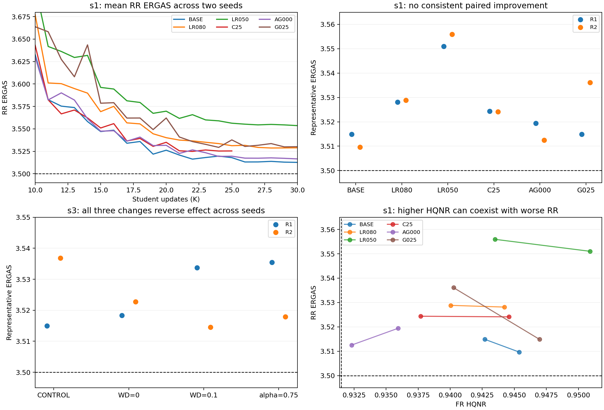

# 2026-10-31 실험 진행 점검 및 QB 결과 분석

확인 시점: **2026-10-31 14:03 KST 전후**. s1은 프로세스·Docker·GPU·원본 평가·checkpoint·게시 영수증을 직접 확인했다. s3는 연결된 Google Sheet의 완료 상태와 게시 provenance를 확인했으며, 원격 프로세스와 디스크를 직접 조회한 것은 아니다.

## 1. 현재 실행 상태

| 서버/데이터셋 | 확인 결과 |
|---|---|
| s1 QB REFIT | 10/10 완료, 실패·조기 중단 0. 마지막 학습 완료 10월 31일 09:53:50 KST. 전체 약 22시간 50분. 대표 10행 게시 및 readback 검증 완료. |
| s1 WV3 TUNE30 | QB 종료 후 09:56경 자동 재개. LR080 R2 완료, **S100DIFFUBILC30LR120 R1 진행 중**. 점검 중 22K→23K로 증가. |
| s3 QB DEEPEN | 새 Stage 1 1개와 Student 8개 **모두 COMPLETED 게시**. Student 각각 candidate_count=30, planned_horizon=30K. 마지막 run 완료 관측 10월 31일 09:16:50 KST. 현재 GPU 점유는 이 세션에서 확인하지 못했다. |
| s3 GF2 | 목표 달성 결과 유지. 뒤에 실행되던 GF2P_C50LR150 R1은 STOPPED 게시로 전환됐다. |

s1 GPU는 RTX 4090, 확인 순간 사용률 36%, 사용 메모리 3,234 MiB. 학습 컨테이너 1개와 priority controller, WV3 publisher가 살아 있다. 낮은 순간 사용률만으로 정지를 판단하지 않았으며, 실제 step 증가를 확인했다. 현재 실패나 게시 정체 증거는 없다.

s1 잔여 순서는 현재 LR120 R1의 나머지 → LR120 R2 → G025 R1/R2 → A0125 R1/R2 → HARD36 12개다. HARD36은 AG000, G000, A000, H050, A050, G100 각각 R1/R2이며 아직 시작하지 않았다. 이번 점검에서는 학습 설정과 큐를 변경하지 않았다.

현재 WV3의 22K는 HQNR 0.958400805 / ERGAS 2.039871187로, ERGAS는 통과하지만 HQNR이 0.000099195 부족하다. 23K는 0.958225739 / 2.041181200이다. 두 시점 모두 공동 목표 달성으로 세지 않는다. Sheet에는 규칙에 따라 HQNR 통과 시점 중 ERGAS가 가장 낮은 **17K, 0.958542047 / 2.051954063**이 대표로 남아 있다. 최신 step과 대표 step이 다른 것은 누락이 아니다.

## 2. 목표 및 최선 결과

- QB: **HQNR ≥ 0.9315 AND ERGAS ≤ 3.5**, 동일 checkpoint.
- GF2: **HQNR ≥ 0.9645 AND ERGAS ≤ 0.522 AND PSNR ≥ 45.08**, 동일 checkpoint.
- WV3: **HQNR ≥ 0.9585 AND ERGAS ≤ 2.040**, 동일 checkpoint.

QB 최선은 여전히 **기존 QB_BASE R2 @26K: HQNR 0.945383746 / ERGAS 3.509656381 / PSNR 38.449570371**이다. ERGAS가 목표보다 0.009656381, 약 0.276% 높다. 이번 추가 Student 18개(s1 10개+s3 8개)에는 목표 달성이 없다. 로컬 네 캠페인의 Student 30개, 공식 평가 863개를 재집계한 결과도 공동 통과 0개다. 이 집계는 Stage 1 Teacher와 이전 SENSOR5 캠페인을 제외한다.

GF2는 **GF2P_C60LR200 R2 @47K: 0.964669488 / 0.514883016 / 45.084138096**로 세 목표를 모두 충족한다. H/E 대표인 43K와 PSNR까지 통과한 47K를 구분해서 보존해야 한다.

## 3. s1 QB: 다섯 설정 × 두 seed 결과

각 숫자는 기존 게시 규칙(HQNR 통과 checkpoint 중 ERGAS 최소)으로 선택한 대표다. 동일 seed의 기존 BASE와 비교했다. 서로 다른 시점의 대표 비교이며, 별도로 고정 step 비교도 수행했다.

| 설정 | R1: step / HQNR / ERGAS | R2: step / HQNR / ERGAS | 해석 |
|---|---|---|---|
| 기존 BASE, C30 LR=1e-4 α=.25 γ=.5 | 29K / .942698 / **3.514885** | 26K / .945384 / **3.509656** | 기준 유지 |
| LR=8e-5 | 30K / .944229 / 3.528125 | 28K / .940048 / 3.528824 | 두 seed ERGAS 악화 |
| LR=5e-5 | 27K / **.950913** / 3.551016 | 30K / .943497 / 3.555931 | 높은 HQNR이 좋은 RR 복원을 뜻하지 않음 |
| C25, LR=1e-4 | 22K / .937684 / 3.524364 | 24K / .944587 / 3.524107 | 짧은 cosine 가설 지지하지 않음 |
| α=0, γ=0 | 27K / .935941 / 3.519430 | 26K / .932305 / 3.512524 | ERGAS 이득 없이 HQNR 여유 감소 |
| α=.25, γ=.25 | 27K / .946965 / 3.514881 | 24K / .940262 / 3.536086 | R1은 HQNR 개선, R2는 악화. 일관된 우위 없음 |

**낮은 LR은 현재 30K 스케줄에서 제외 우선순위가 높다.** 30K 고정 비교에서 LR050은 BASE보다 ERGAS가 R1 +0.036019, R2 +0.045908 높고, RR 20장 중 각각 19장/20장이 악화했다. LR080도 16장/17장이 악화했다. 일부 scene 하나나 대표 시점 선정만으로 생긴 현상이 아니다. 다만 다른 horizon과의 모든 조합까지 배제하는 결과는 아니다.

C25는 같은 25K에서 비교해도 BASE C30보다 ERGAS가 R1 +0.005917, R2 +0.008983 높다. LR을 더 빨리 내려 RR 개선을 앞당긴다는 가설은 이번 QB에서는 실현되지 않았다.

**Hard 가중치 제거가 정체를 풀지 않았다.** α=γ=0은 30K에서 ERGAS가 BASE보다 R1 +0.004574, R2 +0.003192 높으며 HQNR은 각각 −0.006313, −0.012699 낮다. R1에서는 D_s가 오히려 개선됐지만 D_lambda가 +0.010251 증가했고, R2는 D_s와 D_lambda가 모두 나빠졌다. 따라서 HQNR 감소를 모두 공간 정합 문제로 해석하면 안 된다. 현재 가중치는 적어도 이 비교에서 스펙트럼 보존 및 HQNR에 도움이 된다.

γ=.25의 R1 대표 ERGAS 개선량은 약 0.000004로 사실상 동률이다. HQNR +0.004267은 관심을 가질 변화지만, R2 대표 ERGAS +0.026430 및 30K의 17/20 scene 악화를 함께 보면 기본 설정을 대체할 근거는 부족하다.

## 4. s3 QB: 자체 Stage 1을 사용한 결과

s3는 새 seed 261016301로 A200_E030 Stage 1을 학습하고 검증 RRE 기준으로 **39K**를 선택했다. 선택 checkpoint SHA는 `274f7bc3bdcf8ff19ff4733b71834e7d2cd296a1231613c0fe196336ad91d7ae`다. 모든 s3 Student 8개가 이 동일한 **s3 자체 donor**를 사용한 것이 게시 설정에서 확인된다. s1의 44K checkpoint를 전달해서 사용한 결과가 아니다.

| s3 설정 | R1: HQNR / ERGAS | R2: HQNR / ERGAS | BASE 대비 ERGAS 변화 R1 / R2 |
|---|---|---|---|
| CONTROL, WD=.01 α=.25 | .935619 / **3.514980** | .949658 / 3.536875 | 기준 |
| WD=0 | .944978 / 3.518364 | **.952409** / 3.522740 | +.003385 / −.014136 |
| WD=.1 | .941581 / 3.533690 | .939050 / **3.514557** | +.018710 / −.022318 |
| α=.75, WD=.01 | .945642 / 3.535465 | .949292 / 3.517891 | +.020486 / −.018985 |

LR=1e-4、C30、γ=.5、β=0는 공통이다. 위 비교는 서버 내 동일 donor·동일 Student seed 간 대표 결과 비교다. s3 원본 전체 trajectory 및 scene별 결과는 현재 세션에 없어 고정 30K/scene별 비교는 수행하지 못했다.

세 변경 모두 ERGAS 방향이 seed에 따라 반대다. 특히 WD=.1과 α=.75는 R2에서 좋아 보이지만 R1에서 비슷한 크기로 손해를 본다. **새로운 안정적 최적점으로 확정할 수 없다.** WD=0은 두 seed 모두 HQNR이 올랐고, R1의 ERGAS 손해가 비교적 작으며 R2는 개선되어, 이 중에서는 추가 확인 후보로 가장 낫다. 그래도 기존 s1 최선 3.509656을 넘지는 못했다.

s3 선택 donor의 검증 RRE50=.270547, Val_ERGAS=3.935790이며 s1은 RRE50=.235295, Val_ERGAS=3.924386이다. s1 Aligner가 이 검증 지표에서는 더 좋다. 그러나 Student H/E 우열은 seed별로 바뀐다. 서버와 Stage 1 초기화가 함께 바뀌므로 이 두 점만으로 Aligner 품질과 Student 성능의 인과관계나 단조 관계를 확정할 수 없다.

## 5. Student 관점의 해석

새 s1 실험의 실제 RR shift는 BASE와 scene별로 완전히 같았다(30K 비교의 최대 좌표 차이 0). Aligner를 동결했으므로 LR·Hard 계수별 성능 차이는 **Student가 같은 입력에서 학습한 함수의 차이**다. 이번 LR050의 HQNR 상승을 Aligner의 보정량 감소로 설명할 수 없다.

R1 LR050은 30K에서 BASE 대비 D_s −.011584, D_lambda +.003562, HQNR +.007864지만 ERGAS +.036019다. 원본 PAN을 기준으로 측정한 FR 공간 점수와 RR GT 복원 오차가 다른 방향으로 움직인다. 낮은 LR이 제한된 업데이트 안에서 어떤 디테일을 덜 또는 다르게 복원했을 가능성이 있지만, 출력 주파수/밴드별 오차를 직접 측정한 결과는 아니므로 이것을 확정 기전으로 서술하지 않는다.

반대로 이전 LR120과 C40은 학습 GT L1이 낮아져도 RR ERGAS가 나빠졌다. 이번 γ=.25 R2도 25–30K 학습 L1이 BASE보다 약간 낮지만 RR는 나쁘다. 따라서 단순한 학습 부족만으로 정체를 설명하기 어렵다. 독립적인 Stage 2 validation 복원 trajectory가 저장되어 있지 않아 과적합과 학습 목적/평가 지표의 불일치를 분리해서 판정할 수는 없다.

## 6. 다음 방향 제안

1. **현재 기준 설정 유지:** scale 1, 자체 A200_E030/R3 Stage 1, Student C30 LR=1e-4 α=.25 γ=.5 WD=.01. LR050/LR080, C25, AG000, γ=.25의 추가 촘촘한 탐색은 우선순위를 낮춘다. 두 seed 결과를 곧바로 통계적 확증으로 취급하지 않되, 양쪽 seed·다수 scene의 일관된 악화는 반영한다.
2. **WD=0은 제한적으로 재확인:** 각 서버에서 자기 donor를 유지하고 CONTROL과 동일한 추가 Student seed를 짝지어 비교한다. WD=.1과 α=.75보다 양쪽 seed의 HQNR 반응이 일관적이다. 아직 queue에 추가한 것은 아니다.
3. **구조 변경 전에 QB의 DIFF 입력 기여를 분리:** scale 1과 U-Net/스케줄/Hard를 유지하고, `[corrected PAN, corrected PAN−PAN, I_lrms]` 대 `[corrected PAN, I_lrms]`를 같은 조건에서 비교하는 작은 ablation을 우선 제안한다. 기존 Teacher는 RR ERGAS 3.492595지만 FR HQNR .759511이므로 그대로 대체할 수 없다. Teacher/Student 간 차이가 residual, upsampling, 가중치, 학습 기간 중 무엇 때문인지 현재 비교만으로 분리되지 않는다. DIFF 제거가 개선된다는 주장이 아니라, 큰 architecture 탐색 전에 확인할 원인 분리 실험이다. Aligner scale 1 조건은 유지된다.
4. 더 큰 architecture나 새 loss를 먼저 늘리기보다, 각 서버 자체 donor를 유지한 paired 비교와 밴드별·edge/flat별 Teacher/Student 오차 진단을 우선한다. 회전 loss, TTA, SWA, soft loss, 밴드 가중 loss는 제안하지 않는다.

## 7. 게시 및 weight 보존

- s1 신규 10개 대표 + 기존 QB 최선 1개, **11개 checkpoint 실파일 SHA256 = sidecar SHA256 = Sheet SHA256**, H/E/PSNR도 일치했다. 각 파일은 저장되어 있다.
- s3 Student 대표 8개 모두 게시 artifact가 `weights_saved=true`, `SAME_STATE_FILE_SHA256_VERIFIED`다. Stage 1 선택본도 `SELECTED_STAGE1_FILE_SHA256_VERIFIED`다. 이는 원격 게시기가 확인한 기록이며 이번 세션의 직접 원격 디스크 검증은 아니다.
- GF2 47K 목표 달성본도 저장/검증 기록을 유지한다.
- 과거 `QB-ablations!H27`의 QB_H050 R1 ERGAS는 공백 문자열이다. 로컬 공식 값은 **3.5115039342844887**이며 이번 분석은 이 원본 값을 썼다. 신규 18개 게시에는 해당 누락이 없다. 이번 읽기/분석 작업에서는 기존 Sheet 셀을 수정하지 않았다.
- `evaluation_*.json`의 `weights_saved=false`는 저장 이전 평가 레코드에 남은 필드다. 실제 보존 여부는 `models/*.pt`와 저장 후 sidecar·게시 artifact를 기준으로 검증했다.

원본 Sheet: [pan-cvpr27-new](https://docs.google.com/spreadsheets/d/1_ANKPQjQzMZrw9fUc1OI3B9xF4K3sxNa_fybg1kjBXE/edit).

재현 자료: [audit.py](assets/2026-10-31_qb-progress/audit.py), [compare.py](assets/2026-10-31_qb-progress/compare.py), [전체 local trajectory CSV](assets/2026-10-31_qb-progress/trajectories.csv), [검증/비교 JSON](assets/2026-10-31_qb-progress/comparison.json), [Sheet snapshot](assets/2026-10-31_qb-progress/sheet-snapshot.json.gz).

그림의 평균 곡선은 두 seed의 지표 산술평균이며 모델을 평균한 실험 결과가 아니다. 나머지 패널은 각각 독립 모델의 대표 결과다.
