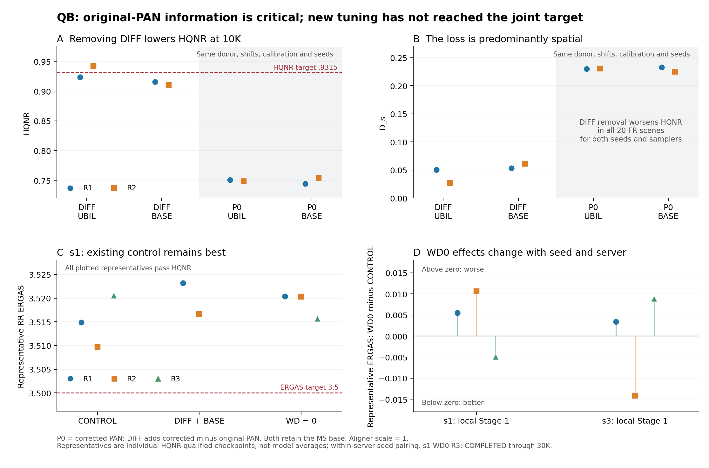

# 2026-11-01 QB 결과 분석과 서버별 40시간 후속 계획

분석 범위: s1 원본 평가·학습 로그·weight·게시 영수증, s3 `QB-ablations`의 실제 게시 결과·완료 상태·provenance.
s3의 원격 프로세스와 전체 scene별 trajectory를 직접 읽은 것은 아니다.
최종 로컬 분석 갱신: **2026-11-01 10:30:36 KST**. 10:32에는 Sheet terminal readback까지 확인했다.
계획 상태는 **PLANNED_NOT_REGISTERED**다. 이번 작업은 분석과 후속 case 설계이며 현재 실행 큐를 바꾸지 않았다.
40시간은 **각 서버에서 후속 캠페인을 시작한 뒤의 예산**이다. 기존 진행분의 시간은 포함하지 않는다.

## 1. 현재 결론

QB 목표는 같은 checkpoint에서 **HQNR ≥ .9315 AND ERGAS ≤ 3.5**다.
현재 최선은 여전히 기존 **QB_BASE R2 @26K: HQNR .945383746 / ERGAS 3.509656381**이다.
ERGAS가 목표보다 .009656381, 약 .276% 높다. 이번 구조·WD 실험은 이 최선을 넘지 못했다.
이번 신규 최선은 **WD000 R3 @29K: H=.945434043 / E=3.515674928**이다.
기존 4개 캠페인과 신규 STRUCTURE를 합친 로컬 Student 40개·공식 평가 1,083개에서 공동 목표 통과는 0개다.
이 집계는 Stage 1 Teacher와 초기 SENSOR5 결과를 제외한다. s3 신규 8개에도 통과본은 없다.

새 실험의 주요 성과는 개선 모델보다 **제외할 방향을 명확히 한 것**이다.

1. **차영상 입력을 유지한다.** corrected PAN만 주는 P0 Student는 두 서버·두 seed·두 업샘플 방식에서 모두 낮은 HQNR로 조기 종료됐다.
2. **UBIL을 유지한다.** 기존 transposed-conv 업샘플로 바꾸면 s1의 RR ERGAS가 두 seed 모두 나빠졌고, s3에서는 HQNR 유지도 어렵다.
3. **WD=.01을 유지한다.** WD0 이득이 서버·seed·scene 전체로 반복되지 않았다.
4. 다음은 **Stage 1 계수의 아직 보지 않은 상단**, **긴 학습과 작은 LR의 조합**, **같은 데이터 노출량에서 batch·update·LR 조합**을 확인한다.

## 2. 현재 진행과 게시

- s1 신규 10개는 **30K 완료 6개 + 10K HQNR 조기 종료 4개**로 모두 종료됐다.
  마지막 WD000 R3는 **10:29:59 KST**에 30K 완료됐고, 29K 대표는 H=.945434043 / E=3.515674928이다.
  캠페인 상태는 `FINISHED_WITH_EXPLICIT_EARLY_STOPS`이며 누락이나 미실행을 뜻하지 않는다.
- s3는 신규 8개 모두 결과가 게시됐다. **30K 완료 4개 + 10K 조기 종료 4개**다. 전부 30K를 학습한 것은 아니다.
- s3의 마지막 WD000 R3 완료 관측은 2026-11-01 00:08:37 KST다. Sheet의 selected step 27K는 완료 시점 30K와 다른 대표 시점이다.
- s1 publisher는 신규 10개 행 readback을 검증했고, 로컬 대표·최종/최신 checkpoint 18개는 실제 SHA256 검증을 통과했다.
  종료 후 R3의 29K 대표·30K 최종 weight도 별도로 재검증했고, Sheet 마지막 행의 `COMPLETED / VERIFIED`도 확인했다.
- s3 대표 8개도 저장 후 검증 기록 `SAME_STATE_FILE_SHA256_VERIFIED`를 갖는다. 이는 원격 publisher의 확인 기록이다.
- 두 서버의 새 calibration은 각각 자기 서버의 과거 R1/R2 대조군과 `EXACT_HISTORICAL_NUMERIC_PARITY`를 통과했다.

기존 자동 실행 순서는 QB_STRUCTURE 종료 후 잔여 WV3 TUNE30/HARD36이다.
10:32:36 KST priority 상태는 `RESUME_TUNE30`으로 전환됐다.
새 40시간안은 아직 이 실행기에 등록하지 않았으므로, 이 문서만으로 자동 전환되지는 않는다.

## 3. 대표 결과와 같은 step 비교

아래 표는 기존 규칙으로 선택한 대표다. H 기준 통과본 중 E 최소이며, H 통과본이 없으면 H 최대다.
서로 다른 대표 step의 수치를 최종 step끼리의 비교로 해석하지 않는다.

| 서버 | 설정 | R1 HQNR / ERGAS | R2 HQNR / ERGAS | 판단 |
|---|---|---|---|---|
| s1 | 기존 DIFF+UBIL, WD=.01 | .942698 / 3.514885 | .945384 / 3.509656 | 기준 유지 |
| s1 | DIFF+BASE | .946635 / 3.523210 | .936383 / 3.516627 | 두 seed RR 악화 |
| s1 | P0+UBIL | .757466 / 3.692479 | .763591 / 3.606869 | 10K 조기 종료 |
| s1 | P0+BASE | .760321 / 3.837344 | .767640 / 3.642081 | 10K 조기 종료 |
| s1 | DIFF+UBIL, WD=0 | .941665 / 3.520405 | .940003 / 3.520305 | 두 seed E 악화 |
| s3 | 기존 DIFF+UBIL, WD=.01 | .935619 / 3.514980 | .949658 / 3.536875 | 자체 donor 기준 |
| s3 | DIFF+BASE | .927679 / 3.585710 | .933455 / 3.610237 | FR 유지 어려움 |
| s3 | P0+UBIL | .776949 / 3.648903 | .778170 / 3.646549 | 10K 조기 종료 |
| s3 | P0+BASE | .794565 / 3.629400 | .779598 / 3.645182 | 10K 조기 종료 |
| s3 | DIFF+UBIL, WD=0 | .944978 / 3.518364 | .952409 / 3.522740 | 과거 R1/R2도 방향 혼재 |

s3 DIFFBASE R1은 30개 checkpoint 중 H 통과가 **0개**, R2는 **1개**다.
따라서 R2 대표 10K의 E=3.610237을 최종 30K의 ERGAS로 적으면 안 된다.
30K까지 학습했으나 H 조건을 만족하면서 E가 좋은 시점을 확보하지 못했다는 결과다.

s1 DIFFBASE를 같은 30K의 UBIL과 비교하면 E 차이는 **+.007920 / +.007557**이고,
RR 20개 scene 중 **13개 / 15개**가 악화했다. 25–30K 평균 차이도 **+.008578 / +.006825**다.
대표 선정의 우연만으로 나타난 손해가 아니다. H 변화는 seed별로 달라 일관된 보상도 없다.

s3에서는 자체 donor와 하드웨어 조건이 함께 달라지므로, BASE의 큰 손해를 특정 donor 하나의 원인으로 단정하지 않는다.
현재 증거로는 이 변경이 조건에 민감하고 두 서버에서 안정적인 개선을 주지 않는다고 판단한다.

## 4. 차영상이 중요한 이유: 입력 정보의 직접 비교

입력은 다음 두 가지였다.

- DIFF: `[P_c, P_c − P, I_lrms]`
- P0: `[P_c, I_lrms]`

`P_c = Lanczos4(P, u)`이며 모두 Aligner scale 1이다.
DIFF에서는 **P = P_c − (P_c−P)**이므로 원본 PAN 정보를 정확히 보존한다.
이 채널을 빼면 Student가 원본 PAN의 위치·세부 정보를 직접 이용할 경로가 사라진다.

동일 sampler·seed의 10K를 비교한 결과는 다음과 같다.

| DIFF 제거 | ΔHQNR | ΔD_s | ΔD_lambda | FR HQNR 악화 scene |
|---|---:|---:|---:|---:|
| UBIL R1 | −.172711 | +.179616 | −.002458 | 20/20 |
| UBIL R2 | −.193280 | +.203783 | −.005352 | 20/20 |
| BASE R1 | −.171293 | +.179643 | −.003139 | 20/20 |
| BASE R2 | −.156607 | +.163883 | −.002927 | 20/20 |

스펙트럼 항은 약간 좋아졌지만 공간 항 손해가 훨씬 컸다.
동일 seed의 실제 Aligner shift, Teacher/q 통계, calibration과 support는 같고,
차영상의 초기 conv 열은 0이어서 초기 예측 함수도 같았다. 입력 경로가 학습 과정에서 만드는 차이다.

s1 Aligner 보정량 norm은 RR 평균 **.425px**, FR 평균 **2.768px**다.
각각 서로 다른 20개 scene 집단이며, 같은 영상을 배율만 바꿔 얻은 관계로 해석하지 않는다.
FR에는 GT가 없고 HQNR은 원본 PAN을 기준으로 하므로, 이 결과는 원본 PAN 접근이 현재 평가·학습 조건에서 중요하다는 근거다.
**실제 FR 보정이 틀렸다는 증명도, Aligner의 순수한 양의 기여를 증명한 결과도 아니다.**
FR scene별 shift 크기와 DIFF 제거에 따른 ΔD_s 상관도 .098–.367로, 보정량 하나만으로 모든 손해를 설명하지 못한다.

RR 변화는 seed에 따라 달랐다. P0−DIFF의 10K E 차이는 UBIL −.035055 / +.027404,
BASE −.071746 / +.012429다. 따라서 DIFF 제거가 항상 RR 개선과 FR 악화를 교환한다고 일반화하지 않는다.
첫 conv norm 비율을 실제 PAN 혼합률로 해석하는 대신, 이번 직접 입력 비교를 근거로 사용한다.

## 5. WD0와 현재 정체의 해석

s1 WD0 R1/R2의 같은 30K E 차이는 기본 WD=.01보다 **+.005898 / +.011941**다.
s1 R3는 더 좋아 보이지만 같은 최종 30K 비교에서 전체 E는 −.006059인 반면,
20개 scene 중 **12개가 악화**했고 중앙값은 +.002529였다.
scene 0은 E가 4.123653→3.914965로 크게 낮아졌다. 이 scene을 제외한 평균 차이는 **+.004605**다.
공식 평균에서 scene 0을 제외하는 것이 아니라, 개선이 어디에서 발생했는지를 진단한 것이다.

s3 R3는 CONTROL H=.943733 / E=3.520641,
WD0 H=.943985 / E=3.529498로 E가 **+.008857** 악화했다.
따라서 WD0를 기본값으로 바꿀 근거는 부족하다.

앞선 LR050/LR080·C25·Hard 제거 결과와 이번 결과를 합치면,
현재 문제를 작은 LR 하나, 업샘플 블록 하나, regularization 하나로 해소했다는 증거가 없다.
현재 기준은 **DIFF+UBIL, W112, B48/C30/LR1e-4, WD=.01, α=.25/γ=.5/β=0**으로 유지한다.

[벡터 PDF](assets/2026-11-01_qb-review/qb_summary.pdf). 그림의 점은 독립 모델 결과이며 모델 평균이나 TTA 결과가 아니다.

## 6. 40시간 후속안의 공통 조건

- QB target은 H≥.9315/E≤3.5를 유지한다.
- PAN Aligner scale 1, RGB 구조 reference, A/T/S Lanczos4, 기존 MS 데이터 경로와 `I_lrms` 표기를 유지한다.
- Student는 모두 fresh 초기화다. soft loss, rotation consistency, TTA, SWA/EMA, 새 loss·band 가중 loss를 추가하지 않는다.
- Stage 1 계수 비교는 **해당 서버의 기존 Stage 1 seed**를 유지한다: s1=261016101, s3=261016301.
- Student R1/R2/R3 seed는 261018101/261018102/261018103이다.
- 새 Stage 1은 각 branch·각 서버에서 독립적으로 50K를 학습하고, 기존 full-horizon validation RRE selector를 그대로 적용한다.
  Teacher FR HQNR로 source 모델을 선택하거나 중단하지 않는다.
- 새 Stage 1 변경은 A/T와 calibration을 함께 바꾼다. 이는 **Stage 1 계수의 전체 파이프라인 효과**이며 Aligner만의 효과로 주장하지 않는다.
- 기존 donor를 쓰는 Student 전용 비교는 s1 자체 44K, s3 자체 39K 선택본을 그대로 사용한다. 다른 서버 weight를 전달하지 않는다.

### 6.1 새 Stage 1: 계수의 상단 탐색

| branch | λ_abs | λ_epsilon | epsilon 반경 | Stage 1 길이 | 의미 |
|---|---:|---:|---:|---:|---|
| 기존 A200_E030 | 2 | .03 | 3px | 완료된 50K | 서버별 대조군 |
| A200_E100 | 2 | .10 | 3px | 새 50K | epsilon 일관성 계수만 약 3.3배 |
| A400_E030 | 4 | .03 | 3px | 새 50K | absolute 정합 계수만 2배 |
| A400_E100 | 4 | .10 | 3px | s3 새 50K | 두 계수 상호작용 |

이전에는 λ_epsilon=.01/.003, λ_abs=1 등 낮은 방향의 결과가 불리했다.
높은 방향의 효과는 아직 확인되지 않았으므로 범위를 넓혀 독립적으로 시험한다.
`.10`은 epsilon **loss 계수**이며 주입 shift 반경을 바꾸는 값이 아니다.
각 새 donor 뒤에 표준 DIFF+UBIL/C30/LR1e-4 Student를 같은 seed로 학습한다.
s3의 세 새 branch와 기존 branch로 Stage 1 계수 2×2 비교가 구성된다.

### 6.2 긴 스케줄과 batch·LR 비교

| Student recipe | Batch | Updates | LR peak | Warmup | 학습 sample 제시 횟수 | 근사 ∑LR |
|---|---:|---:|---:|---:|---:|---:|
| 기존 기준 | 48 | 30K | 1e-4 | 100 | 1.44M | 1.5 |
| C60LR050 | 48 | 60K | 5e-5 | 100 | 2.88M | 1.5 |
| B96C15LR100 | 96 | 15K | 1e-4 | 50 | 1.44M | .75 |
| B96C15LR200 | 96 | 15K | 2e-4 | 50 | 1.44M | 1.5 |

모두 warmup 후 cosine→0이며 microbatch 12를 유지한다. B96은 gradient accumulation 8회다.
C60LR050은 이전 C30LR050 실패와 다른 질문이다. 작은 LR을 쓰되 데이터 노출을 두 배로 늘리면 RR 개선을 회복하는지 확인한다.
반면 기존 C40/LR1e-4의 단순 연장은 불리했으므로 같은 설정을 더 길게 반복하지 않는다.

B96 두 case는 기준과 총 sample 제시 횟수를 맞추고, 서로 LR만 다르게 한다.
Batch 변경은 update 수와 Adam moment의 sample 단위 기억 길이도 바꾸므로 순수 gradient noise의 효과라고 부르지 않는다.
∑LR 일치도 Adam 경로나 실제 parameter 이동이 같다는 뜻은 아니다.

### 6.3 후순위 s3 복합 후보

`W128H050`: 기존 자체 donor, DIFF+UBIL, W128, α=.125, γ=.25, β=0, C30/LR1e-4/WD=.01.
과거 s1에서 W128과 H050 각각은 E 약 3.511 수준이었지만 확실한 우위는 없었다.
두 변경을 결합한 후보를 s3에서 R1/R2로 확인한다. s3에 각각의 단독 대조군이 모두 있는 것은 아니므로
이 case는 **복합 recipe 탐색**이며 두 요소의 독립 효과를 분해한 ablation으로 해석하지 않는다.

## 7. 서버별 전체 계획과 시간

실측 full-run 기준 30K Student는 s1 약 **2.41h**, s3 약 **1.67h**다.
Sheet의 대표 시점 `Wall(h)`를 전체 run 시간으로 사용하지 않았다.
새 Stage 1 50K와 선택 절차에는 s1 **3.10h**, s3 **2.10h**를 배정한다.
s3 Stage 1은 일부 외삽을 포함하며, B96 및 s3 W128 비용은 실행 전 profiling으로 보정해야 한다.

| 후속 항목 | s1 Student 수 | s3 Student 수 | 별도 Stage 1 |
|---|---:|---:|---|
| A200_E100 표준 Student | R1/R2: 2 | R1/R2/R3: 3 | 각 서버 새 50K 1개 |
| A400_E030 표준 Student | R1/R2: 2 | R1/R2/R3: 3 | 각 서버 새 50K 1개 |
| A400_E100 표준 Student | 0 | R1/R2: 2 | s3 새 50K 1개 |
| C60LR050 | R1/R2: 2 | R1/R2: 2 | 기존 자체 donor |
| B96C15LR100 | R1/R2: 2 | R1/R2: 2 | 기존 자체 donor |
| B96C15LR200 | R1/R2: 2 | R1/R2: 2 | 기존 자체 donor |
| W128H050 | 0 | R1/R2: 2 | 기존 자체 donor |
| **합계** | **새 Stage 1 2개 + Student 10개** | **새 Stage 1 3개 + Student 16개** | |

**s1 순서:** E100 Stage 1→Student R1/R2 → C60LR050 R1/R2 → A400 Stage 1→Student R1/R2
→ B96LR100 R1/R2 → B96LR200 R1/R2.

**s3 순서:** B96LR100 R1/R2 → B96LR200 R1/R2 → E100 Stage 1→Student R1/R2
→ A400 Stage 1→Student R1/R2 → C60LR050 R1/R2 → A400_E100 Stage 1→Student R1/R2
→ E100 R3 → A400 R3 → W128H050 R1/R2.

| 서버 | 학습·평가 기본 추정 | 여유 예산 | 합계 |
|---|---:|---:|---:|
| s1 | 35.12h | 4.88h | 40h |
| s3 | 36.36h | 3.64h | 40h |

여유에는 실제 graph profiling, 새 donor의 검증 선택·full-training calibration, 처리 속도 변동과 게시 마감을 포함한다.
조기 종료가 발생할 것이라고 가정해 시간을 줄이지 않았다. Stage 1은 full 50K를 마친 뒤 선택한다.
실행 시에는 측정된 다음 run 전체 예상 시간과 마감 여유가 남은 예산 안에 들어가는지 확인한다.
들어가지 않는 후순위 case는 미시작 pending으로 남겨야 하며 완료로 표시하지 않는다.

## 8. 비교와 게시에서 지킬 기준

- 기존 **8K·9K·10K HQNR이 모두 .90 미만이면 중단**하는 규칙을 유지한다. Stage 2만 대상이다.
  B96의 이 시점은 기존 B48보다 두 배 많은 sample을 본 뒤이므로 중단 여부 자체를 동등한 노출량의 과학적 비교로 보지 않는다.
- official 평가는 1K마다 유지한다. C60은 후보 60개, C30은 30개, C15는 15개이므로 대표 최솟값만으로 우위를 판단하지 않는다.
- 추가 분석은 최종값, 같은 sample 노출량, 마지막 구간, RR scene별 중앙값·개선 scene 수를 함께 본다.
  같은 후보 수의 보조 비교에는 **15개 공통 진행률 지점**을 쓴다: C15는 1K마다, C30은 2K마다, C60은 4K마다.
  이 보조 분석은 공식 Sheet 대표 선정 규칙을 바꾸지 않는다.
- 새 Stage 1마다 validation RRE, RR/FR 실제 shift 분포, Student D_s/D_lambda 및 공동 목표를 함께 본다.
- `QB-ablations`: 같은 checkpoint의 공동 목표 통과본 모두 + H 통과본 중 E 최소 대표 하나, H 통과본이 없으면 H 최대 대표 하나.
- 모든 평가 weight와 완전 resume state, A/T 출처, calibration을 보존한다.
  Stage 1 계수·Stage 2 α/γ, batch, horizon, LR, width, 자체 donor 출처를 게시 설명에 포함한다.

이 분석은 탐색용 테스트 결과를 사용한다. 작은 seed별 차이를 절대적인 성능 순위나 독립 최종 검증으로 취급하지 않는다.

## 9. 산출물

- [선언형 계획 JSON](../config/panda_qb40/plan.json)
- [s1 전체 case CSV](../config/panda_qb40/cases_s1.csv), [s3 전체 case CSV](../config/panda_qb40/cases_s3.csv)
- [로컬 원본 분석](assets/2026-11-01_qb-review/local_analysis.json), [재현 스크립트](assets/2026-11-01_qb-review/local_analysis.py)
- [Sheet 조회 snapshot](assets/2026-11-01_qb-review/sheet_snapshot.json), [runtime·weight 검증](assets/2026-11-01_qb-review/runtime_audit.json)
- [마지막 완료 행 재조회](assets/2026-11-01_qb-review/final_sheet_row.json), [종료·최종 weight 재검증](assets/2026-11-01_qb-review/completion_snapshot.json)
- [계획 생성·의존성과 시간 검산](assets/2026-11-01_qb-review/build_plan.py)

위 JSON/CSV는 실행기에 등록된 config가 아닌 후속 설계 산출물이다.
실행 구현에서는 가변 batch/accumulation과 15K·60K horizon, 새 Stage 1 계수·자체 선택본 연결을 실제 경로에서 지원하고
preflight·resume·게시 검증을 마친 뒤 큐에 연결해야 한다. 이번 분석 작업은 GPU 학습이나 프로세스를 변경하지 않았다.
